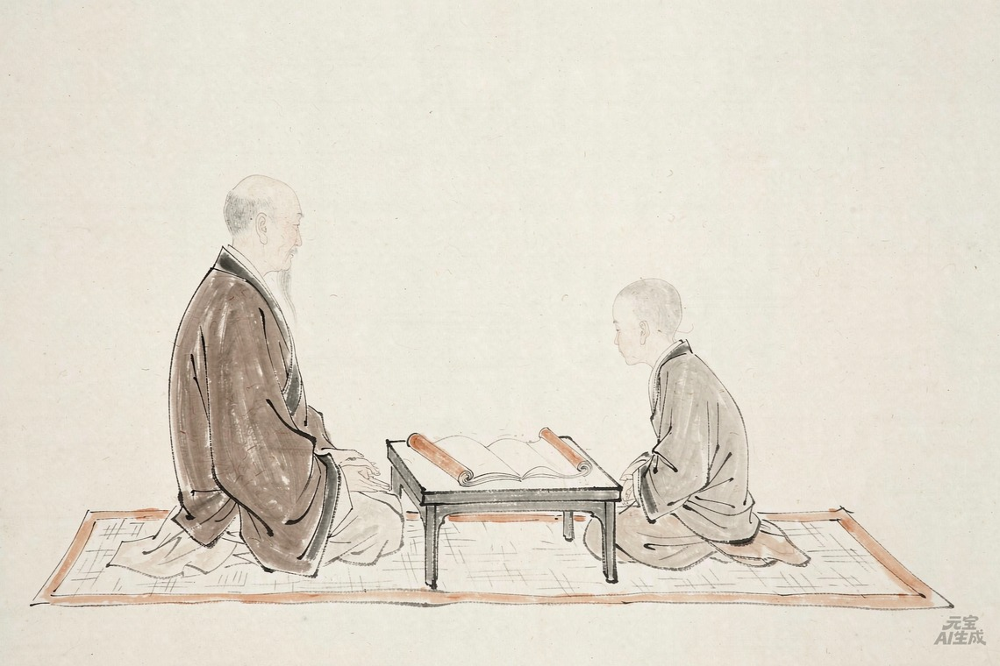

# 第二课　贤者狎而敬之　畏而爱之

> 曲礼上 · 一·三 · 第 2 课

## 一　解题

上一课立了「毋不敬」这条根，这一课马上给出敬的第一个对象：贤者。

**说什么事**：说与德胜于己者相处的分寸。近他，而不慢他；服他，而不远他。

**落在哪一层**：义。不是仪节——此处无一动作可照做；是说心该怎么摆。

**为何编在此位**：因为「敬」一立，最容易走成两条歪路：敬而远之，成了冷淡；亲而慢之，成了轻薄。这一句正卡在两条歪路中间，是「敬」字的第一次落地。放在第二课，是拿它给敬定温。

## 二　经文

【经】賢者狎而敬之，畏而愛之。

## 三　字义与句读

**狎**　郑注：「狎，習也，近也，謂附而近之，習其所行也。」狎不是玩弄，是亲近、是跟着他学。郑引《月令》「雖有貴戚近習」，证狎即近习之义。今人多以「狎」为轻慢，是后起之义，此处不可用。

**而**　两处「而」都是转折兼黏合：既狎，又敬；既畏，又爱。一句里塞进两个反向的动作，正是此句的全部难处。

**畏**　郑注：「心服曰畏。」四个字定案。畏不是怕他，是心里服他。郑又引曾子「吾先子之所畏」，说这种畏是敬服，不是恐惧。

**愛**　爱在此不是私昵。与「畏」并举，是从服其德而生的一种亲。

**句读**　「贤者狎而敬之」的主语不是贤者，是与贤者相处的人。若读作「贤者待人，狎而敬之」，就变成了贤者的修养条目，与下句「畏而爱之」不相对。两句同主一「之」——那个贤者。

## 四　今译

对贤者，要亲近他，又要敬重他；要心服他，又要爱他。

## 五　章旨

近之而不慢，服之而不疏。敬不生距离，爱不生轻慢。

## 六　礼义

**第一层　近与敬**　凡亲近，天然带着轻慢的势：见他吃饭睡觉、见他发火失手，那层「德」的光就淡了。所以「狎而敬之」不是两个动作并列，是一件事的两面——越近，越要记得他凭什么值得敬。这就是郑注「習其所行」的分量：跟的是他的行，不是他的热闹。

**第二层　畏与爱**　「心服曰畏」——畏的对象是他的德，不是他的位。服一个人而不爱他，服就成了隔；爱一个人而不服他，爱就成了黏。此句要求两者同时成立，等于说：真正让人服的德，本就会让人愿意亲近；真正亲近，也当以服为前提。

**第三层　与今日何干**　今日对「贤者」的处理常走两个极端：一是造神，敬到不能近，近了就失望；二是祛魅，近到不能敬，一熟就轻薄。此句给出的解法很朴素：把他的行当作要学的东西，把他的人当作可近的人。学到的东西越多，敬越实；人越近，爱越真。

## 七　分寸与边界

- **不可**把「狎」读成轻慢或戏弄。郑注明说是「近而习其所行」，一字之差，此句就反面了。
- **不可**把「畏」读成恐惧或畏惧权势。郑注「心服曰畏」四字是硬界；服的是德，不是位。
- **不可**只敬不亲，把「敬」做成距离。敬而远之，是此句要修的第一种病。
- **不可**只亲不敬，把「熟」当「知」。熟而生慢，是此句要修的第二种病。
- **不可**用此句教人攀附。敬贤者之所以敬，在其行；若敬的是他能给你的东西，所敬已非贤者。

## 八　存疑

- **狎字两训**　郑训「习、近」；后世有训「狎，亲也」而不含习义者。本课从郑，因下文「敬之」「爱之」皆须有一个「学他什么」的落点，若只训亲，全句就只剩态度。
- **主语**　主语是否可读作贤者自身（即「贤者待人，狎而敬之」）。本课不从，理由见句读；但古注亦有作修养条读的，入此备考。
- **「畏」的出处**　郑注引曾子语，今本《礼记》《论语》未见完全对应之文，或是郑所见别本。此处只取「畏为心服」这一训，不追其出处。
- **贤者所指**　德胜之人，抑或位尊之人？郑注未明言。本课取德，因「畏」若解为服其位，与「爱」并举则不通。
- **两句次序**　先狎后敬、先畏后爱，是否即「由近入敬、由服生爱」的次第？郑注未说。本课取为次第，亦承认或只是修辞的对举。

## 九　跨典

- 《论语·季氏》16.8：「君子有三畏：畏天命，畏大人，畏圣人之言。」——彼「畏」与此「畏」同训：心服而不敢慢。
- 《论语·学而》1.8：「君子不重则不威，学则不固。」——「重」即敬之在人身上者，可与此课第一层对读。
- 《礼记·学记》：「师严然后道尊，道尊然后民知敬学。」——严与敬之关系，可与此课参看：严不是冷。
- 《孟子·离娄下》：「人之患在好为人师。」——反面之证：好为人师者，正缺「畏而爱之」这一头。

## 十　双卡

| 左 | 右 |
| --- | --- |
| 狎：近他，学他的行 | 敬：越近越记得他凭什么可敬 |
| 畏：心服其德 | 爱：服而后愿亲，不是黏 |
| 敬而远之：冷，是第一种病 | 熟而生慢：薄，是第二种病 |
| 敬其德，不敬其位 | 敬其所能，不是敬其所与 |

## 十一　图

<figure>

<figcaption>图一 · 一长一少对坐，中隔一只矮几 · lj002a（作者供图）</figcaption>
</figure>

{{fig:lj002b-xia-jing-wei-ai|图二 · 近而敬　服而爱 · lj002b}}
