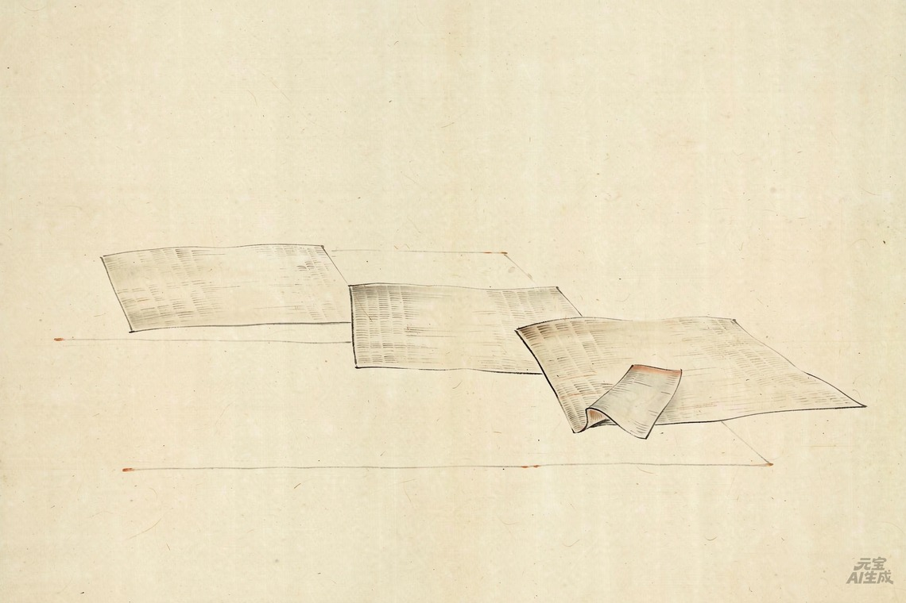

# 第十一课　不逾节　不侵侮　不好狎

> 曲礼上 · 一·十二 · 第 11 课

## 一　解题

上两课管口，这一课管身：不越分，不欺人，不亵近。

**说什么事**：三句，一句一种越界——越分、越人、越亲。

**落在哪一层**：义。三句看似三事，根只一「敬」。

**为何编在此位**：一·十讲四判，一·十一讲持尺之口，此课讲持尺之身。判得清，身才站得住；身站不住，判也就作废。

## 二　经文

【经】禮不踰節，不侵侮，不好狎。

## 三　字义与句读

**逾节**　疏：「礼者，所以辨尊卑，别等级，使上不逼下，下不僭上，故曰礼不逾越节度也。」节是分，不是限。

**侵侮**　疏：「礼主于敬，自卑而尊人，故戒之不得侵犯侮慢于人也。」

**好狎**　郑注：「习近为好狎。」疏：「贤者当狎而敬之，若直近而习之，不加于敬，则是好狎。」——「好」读去声，是嗜好之好，不是「友好」。

**三者的共同**　集说：「逾节则招辱，侵侮则忘让，好狎则忘敬，三者皆叛礼之事。」

## 四　今译

礼不越过名分，不侵犯轻慢人，不以亲近相习为乐。

## 五　章旨

三句管三种越界：越分、越人、越亲。三界只有一条根——敬。

## 六　礼义

**第一层　节是分，不是限**　今人说「节」多作限制解；疏解作「辨尊卑，别等级，使上不逼下，下不僭上」。可见逾节有两头：上逼下是逾，下僭上也是逾。此句从来不只是替上者说话。

**第二层　一硬一软**　侵侮是硬犯，好狎是软犯。硬犯易见，软犯难察：同桌、同饮、同谑，皆可无犯之名而有犯之实。集说以「忘让」「忘敬」对举，正指此处。

**第三层　与一·三对读**　一·三说「贤者狎而敬之」，此课说「不好狎」。同一「狎」字，一许一禁，界在敬之有无：狎而敬，是近而不失；好狎，是近而忘敬。两课合看，方知「狎」不是罪，「好」才是。

**第四层　三叛一根**　逾节是忘了人的位，侵侮是忘了人的尊，好狎是忘了人的界。三者所叛，其实只有一「敬」。敬不是畏，是把对方当作一个有界限的人看待——他站在哪里，他到哪里为止，都算数。

**与今日何干**　今日的越界多在第三句：以「我们熟」为名，翻人手机、问人薪数、拿人痛处当笑料。此句给一个字作界：好。你是在敬他，还是在好他？

## 七　分寸与边界

- **不可**把「不逾节」做成自卑。疏两头都说：上不逼下，下不僭上。
- **不可**把「不侵侮」做成不回嘴。侵侮是犯，拒犯不是犯。
- **不可**把「不好狎」做成不近人。一·三明许「狎而敬之」，此只禁一「好」。
- **不可**把「不好狎」做成假客气。敬不是距离；远而冷，亦非礼。
- **不可**把三句只用来责下。三句通上下，凡有分处皆然。
- **不可**把「节」做成死规矩。一·九已言「礼从宜」；可变者节目，不可变者分。

## 八　存疑

- **「好狎」之读**　郑注「习近为好狎」，好读去声；有读上声作「友好」者，义亦通。本课从郑。
- **「为伤敬也」一句**　《礼记训纂》引注有此语，《礼记述注》本无，疑属「不好狎」句下。本课引其意，不坚分句属。
- **三句是否一组**　陈澔以三者为「皆叛礼之事」，是一组；朱子则逐句分释。本课从陈澔之合。
- **「节」之所指**　疏以尊卑等级为节；朱子以「礼有常度」为说。一重分位，一重常度，本课两取。
- **侵侮与狎之界**　侵侮有加害之意，狎无加害而有失敬。二者以「有意」与「无状」分，不以轻重分。

## 九　跨典

- 《礼记·曲礼上》一·三：「贤者狎而敬之，畏而爱之。」——本课第三句之反面许可，两课对读方通。
- 《礼记·曲礼上》一·九：「礼从宜，使从俗。」——节目可变、分不可变，此其证。
- 《礼记·表记》：「君子不失足于人，不失色于人，不失口于人。」——三不失，正对三越。
- 《论语·学而》1.13：「恭近于礼，远耻辱也。」——集说「逾节则招辱」之所本。
- 《礼记·曲礼上》一·一：「毋不敬。」郑注：「礼主于敬。」——三叛一根，开篇已立。
- 《孟子·离娄下》：「君子所以异于人者，以其存心也。」——界不在远，在存心。

## 十　双卡

| 左 | 右 |
| --- | --- |
| 不逾节：上不逼下，下不僭上 | 不侵侮：自卑而尊人 |
| 不好狎：近而习之，不加于敬 | 狎而敬之：近而不失（一·三） |
| 硬犯易见 | 软犯难察 |
| 三叛一根：失敬 | 敬非畏，是把人当有界之人 |

## 十一　图

<figure>

<figcaption>图一 · 三席远近，界淡而不设栏 · lj011a（作者供图）</figcaption>
</figure>

{{fig:lj011b-san-yue-yi-jing|图二 · 三越，一根界：敬 · lj011b}}
