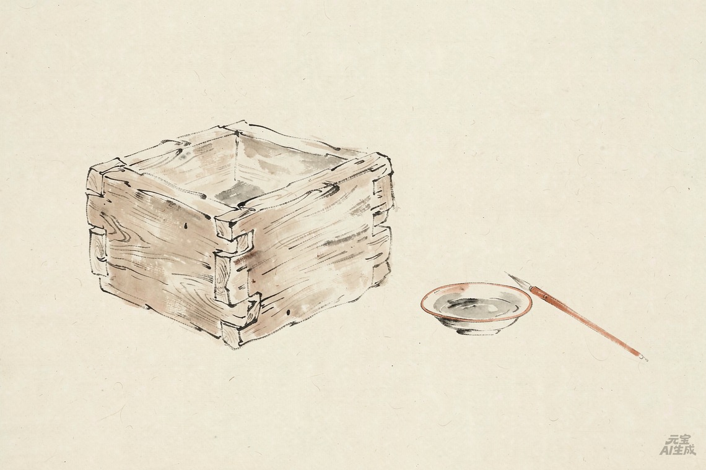

# 第十二课　修身践言　行修言道

> 曲礼上 · 一·十三 · 第 12 课

## 一　解题

上一课说不许言过其行；这一课给出正面：言行相副，就是礼的质。

**说什么事**：修身而履其所言，叫做善行；行已修、言合于道，这就是礼的本。

**落在哪一层**：义。这一句把「礼」从节目拉回人身上：礼有文有质，质在人。

**为何编在此位**：一·十言礼之能（四判），一·十一、一·十二言持礼者之戒；戒完了，须给出正面——什么叫够格。故一·十三言「质」。

## 二　经文

【经】修身踐言，謂之善行；行修言道，禮之質也。

## 三　字义与句读

**修身**　疏以「忠信之行修」释「行修」。所修者是忠信之行，不是仪容，也不是声名。

**践言**　践，履也。说了就去做，如履其地，一步一脚。

**善行**　行读去声，指行事之迹。疏：「忠信之行修」，则所行皆善。

**行修**　行已修。

**言道**　郑注：「言道，言合于道也。」注意：不是「说出来的道理」，是「所说合于道」。一「合」字最实。

**质**　疏：「质，本也，则可与礼为本也。」质是本，不是简陋；礼以文饰，而本在忠信。

## 四　今译

修身而履其所言，叫做善行；行已修、言合于道，这就是礼的本。

## 五　章旨

礼有文有质：文在节目，质在言行。言行相副，才够得上「礼」这个字。

## 六　礼义

**第一层　一句的两半**　「修身践言」说做，「行修言道」说成。前句以「言」为宾语（践言），后句以「道」为宾语（言道）——同一张嘴，前番是践，后番是合。疏把两句都归到「忠信」：忠信立，则言行皆有所本。

**第二层　质是本，不是粗**　今人读「质」多作质朴、粗糙，与「文」对立。疏解作「本」：礼以文饰，而质在其下；文可增损，本不可无。因为质是本，下文一·十五才敢说「道德仁义，非礼不成」——非文不成器，非本则器无所立。

**第三层　陈澔的门槛**　「人之所以为人，言行而已；忠信之人可以学礼，故曰礼之质也。」此语把门槛说清了：学礼不是先学仪，是先要有一箇可教之质。无质而学仪，学成的是样子。

**第四层　方氏的始末**　方氏以《曲礼》此言为「始」，《乐记》「中正无邪，礼之质也」为「终」：行修言道，是入礼之门；中正无邪，是礼成之验。同一「质」字，一在门外，一在门内。

**与今日何干**　今日「人设」二字最盛：言在前，行在后，甚或行不必有。此句的判法只有两条：说过的话有没有去做；做过的事合不合所说的道。两条都过，才有质；过一条，是半个人设。

## 七　分寸与边界

- **不可**把「修身」做成修饰。修的是忠信之行，不是仪容，不是声名。
- **不可**把「践言」做成履约。践是履道，不是把话兑现就算；所践之言须先是「道」之言。
- **不可**把「质」做成粗糙。质是本，本之上仍须文；无文之质，礼不成器。
- **不可**把「言道」做成讲道理。郑训「言合于道」，重在一「合」字，不在辩口。
- **不可**只责人而不责己。此句是自勘语，不是量人尺。
- **不可**把「善行」做成善名。行善而求名，仍是言行不副。

## 八　存疑

- **「善行」之行读**　去声，指行事之迹，与「修身」相对；有读平声作「善的行止」者，义可通。本课从去声。
- **「行修言道」之断**　一读「行修／言道」两句并列（本课所取）；一读「行修言，道礼之质也」。后读文气不顺，从前者。
- **「质」之训**　郑、孔皆训「本」；《乐记》「中正无邪，礼之质也」之「质」偏于质实。本课以「本」为主，兼取《乐记》。
- **与上句是否文连**　朱子以此篇杂取诸书，谓「礼不妄说人」以下各是一书之语。本课取义连，不取文连。
- **忠信与质是否同一**　疏以忠信为本，陈澔以忠信为可学礼之质。一为德，一为本，是否同物？本课谓其意相近，不细分。

## 九　跨典

- 《礼记·乐记》：「中正无邪，礼之质也。」——同字异位，方氏始末说所本。
- 《礼记·表记》：「君子耻服其服而无其容，耻有其容而无其辞，耻有其辞而无其德，耻有其德而无其行。」——四耻层层剥到「行」，此课之实。
- 《论语·学而》1.13：「信近于义，言可复也。」——言可复，即「践言」。
- 《周易·乾·文言》：「修辞立其诚，所以居业也。」——修其辞以立诚，与「言道」相参：辞不立诚，则费。
- 《礼记·缁衣》：「言有物而行有格也。」——言行各有所据，正是「质」的注脚。
- 《礼记·曲礼上》一·十一：「礼不妄说人，不辞费。」——反面之戒，此课正面之立。

## 十　双卡

| 左 | 右 |
| --- | --- |
| 修身践言：说过的去做 | 行修言道：做过的合道 |
| 质是本，不是粗 | 文可增损，本不可无 |
| 忠信之人可以学礼 | 无质而学仪，学成样子 |
| 行修言道，是入门 | 中正无邪，是成验 |

## 十一　图

<figure>

<figcaption>图一 · 朴器未漆，漆未开，笔未蘸 · lj012a（作者供图）</figcaption>
</figure>

{{fig:lj012b-yan-xing-liang-he|图二 · 言行两合，礼乃有质 · lj012b}}
