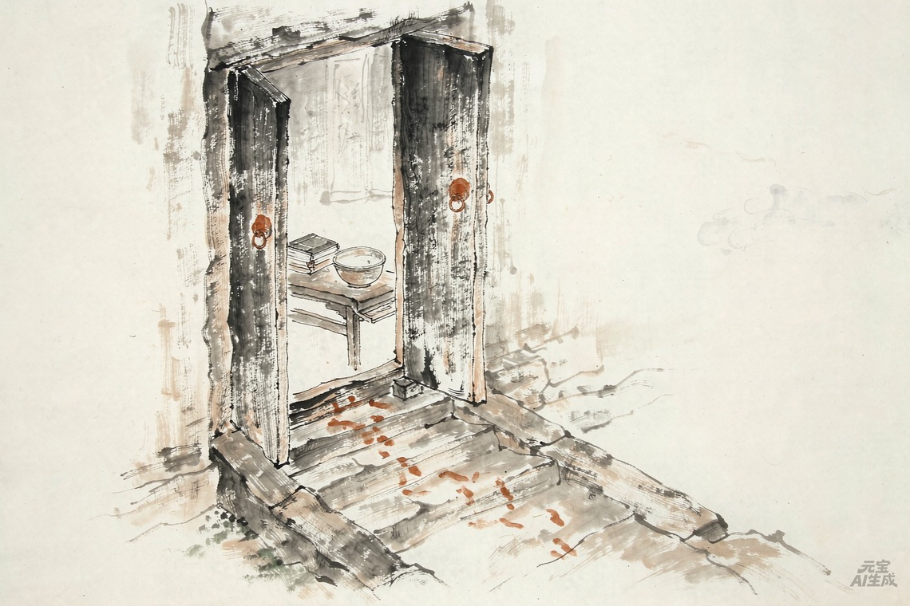

# 第十三课　取于人　来学

> 曲礼上 · 一·十四 · 第 13 课

## 一　解题

上一课讲质，这一课讲质怎么传：只能等人来取，不能去抓。

**说什么事**：礼只听说从人身上取法，没听说把人取来授位；只听说人来学，没听说往教。

**落在哪一层**：教。这是《曲礼》第一次直说「教」的姿势。

**为何编在此位**：质立住了才谈传授。有质而往教，是挟质以骄人；无质而往教，是以空器诱人。

## 二　经文

【经】禮聞取於人，不聞取人；禮聞來學，不聞往教。

## 三　字义与句读

**取于人**　朱子：「为人所取法也。」取之者在人，被取者在我。

**取人**　郑注（疏引）：「谓君人者。」疏：「不闻直取贤人，授之以位，制服而已。」——取人是把人拿来用。

**来学**　人来，我不去。

**往教**　我去，人不来。

**两句是一事**　朱子：「来学往教即其事也。」前句说取的方向，后句说学的方向。

## 四　今译

礼只听说让人从我这里取法，没听说把人取来授职；只听说人来学，没听说我去教。

## 五　章旨

道不可往授，只可来取。师的位置在「待」，不在「招」。

## 六　礼义

**第一层　方向之别**　同一「取」字，方向一反，礼就两样：取于人，是把我的德行摆在人可取之处；取人，是把人摆在我可用之处。前者以人为目，后者以人为器。疏把「取人」解作「授之以位，制服而已」——给了位、穿了服，人就成了制度里的一件。

**第二层　来学与往教**　朱子断得干脆：「取于人者，为人所取法也；取人者，人不来而我引取之也。来学往教即其事也。」往教的难处不在辛苦，在错位：教者先动了，学者还没动。而学的一半正在学者那一动；教者代他动了，学就只剩听。

**第三层　与《孟子》对读**　朱子又云：「此与孟子治人治于人、食人食于人意相类。」治人者役人，治于人者役于人；食人者受人养，食于人者自养。同一句法，主动与被动一换，义全反。此句的筋骨就在这一副对仗里。

**第四层　「待」的礼**　「不闻往教」不是不教，是教有其次。礼给教者一箇姿态：把东西备好，把门开着，等人来。这姿态今日看像消极，其实是把「学」的主权还给学者——不还，学不成。

**与今日何干**　今日教与学都急：课要推、内容要投、观点要塞。此句给一箇反问：这是他要的，还是我要给的？他要，才叫学；我要给，多半只是我说。

## 七　分寸与边界

- **不可**把「不闻往教」做成不教。礼所禁的是「往」，不是「教」；门开着，人来了就教。
- **不可**把「取于人」做成自抬。摆在可取之处，不是摆出可卖之价。
- **不可**把「取人」只解作征辟。凡以位、以利、以势引人从我，皆是取人。
- **不可**把「来学」做成坐等。待是备好而待，不是闲着而待；无物可取而等人来，是空门。
- **不可**用此句拒人问学。人有问，是已来；已在门前，不可推。
- **不可**把此句做成师道之尊。此句约束的是师，不是学者。

## 八　存疑

- **郑注之文**　疏引郑「谓君人者」；注本此句或作「取人，谓制服其身」。二语所指略异：一谓君人之位，一谓制服之仪。本课两存，义从「以人为器」。
- **两「取」是否同字**　取于人，取之在我；取人，取之在人。同字异向，注家无异议。
- **两句是否一事**　朱子以「来学往教即其事」合之；亦有分为取人、教学两事者。本课从朱子。
- **「往教」之界**　何谓往？身至其门为往，抑言至其前亦为往？本课取宽解：以言相强、以术相诱，皆往之类。
- **是否专为君言**　郑有「君人者」之语，似专指取人；「来学往教」则通于师弟子。本课分看，不混一。

## 九　跨典

- 《孟子·滕文公上》：「劳心者治人，劳力者治于人；治于人者食人，治人者食于人。」——朱子所比之句法，主动被动一换义反。
- 《周易·蒙》：「匪我求童蒙，童蒙求我。初筮告，再三渎，渎则不告。」——「来学不往教」之根，蒙卦已言之。
- 《礼记·学记》：「学然后知不足，教然后知困。……故曰教学相长也。」——教非不教，是不往教；教者亦因教而自反。
- 《礼记·曲礼上》一·十三：「行修言道，礼之质也。」——所取者何？取此质也；无质则无可取。
- 《礼记·学记》：「凡学之道，严师为难。师严然后道尊，道尊然后民知敬学。」——师之尊在道，不在招。

## 十　双卡

| 左 | 右 |
| --- | --- |
| 取于人：我的德行摆在可取处 | 取人：人摆在我可用处 |
| 来学：人来，我不去 | 往教：我去，人未来 |
| 取人是授位制服而已 | 学的一半在学者那一动 |
| 待是备好而待 | 门开着，人来了就教 |

## 十一　图

<figure>

<figcaption>图一 · 半开门，盂中水满不溢 · lj013a（作者供图）</figcaption>
</figure>

{{fig:lj013b-dao-ke-lai-qu|图二 · 道可来取，不可往授 · lj013b}}
