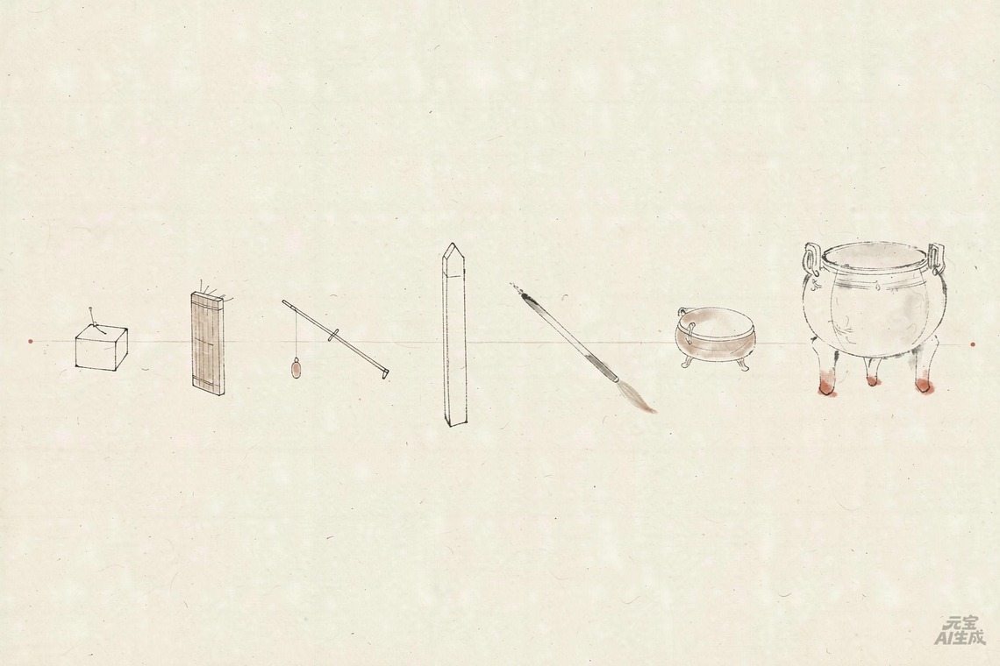

# 第十四课　道德仁义　非礼不成

> 曲礼上 · 一·十五 · 第 14 课

## 一　解题

这一节是全篇最长的一串：七件事，七个「非礼不……」。它不是七条戒律，是一张清单——礼在这七处各做什么。

**说什么事**：道德仁义、教训正俗、分争辨讼、君臣上下父子兄弟、宦学事师、班朝治军涖官行法、祷祠祭祀供给鬼神，七事皆待礼而成。

**落在哪一层**：义。前十三课讲人的分寸，这一课忽然放大：礼不只是修养，是七事成立的条件。

**为何编在此位**：一·十三给人格（质），一·十四给传授（教）；人格与传授都立住了，才敢说礼之大用。故一·十五为上半段之极。

## 二　经文

【经】道德仁義，非禮不成；教訓正俗，非禮不備；分爭辨訟，非禮不決；君臣、上下、父子、兄弟，非禮不定；宦學事師，非禮不親；班朝治軍，涖官行法，非禮威嚴不行；禱祠祭祀，供給鬼神，非禮不誠不莊。

## 三　字义与句读

**道**　疏：「道者通物之名。」陈澔：「道犹路也，事物当然之理，人所共由故谓之道。」

**德**　疏「得理之称」；陈澔「行道而有得于身故谓之德」。

**仁**　疏「施恩及物」；陈澔「仁者心之德，爱之理」。

**义**　疏「裁断合宜」；陈澔「义者心之制，事之宜」。

**成**　四者「由礼而入，以礼而成」。成不是「做出」，是「成形」。

**备**　具备。疏引熊氏：「教谓教人师法，训谓训说义理，以此教训，正其风俗，非得其礼，不能备具。」

**决**　断。郑云：「争罪曰狱，争财曰讼。」礼所以正曲直、明是非。

**定**　定位。疏：「君父南面，臣子北面……唯礼能定也。」

**亲**　相亲。疏引熊氏：「宦谓学仕官之事，学谓习学六艺，此二者俱是事师，非礼不亲。」

**威严**　陈澔：「威则人不敢犯，严则人不敢违。」

**诚庄**　诚出于心，庄形于貌。疏：「求福曰祷，得求曰祠，牲币之属以供给鬼神。」

## 四　今译

道德仁义，没有礼就不成形；教训正俗，没有礼就不周全；分争辨讼，没有礼就断不了；君臣上下父子兄弟，没有礼就定不了位；宦学事师，没有礼就不相亲；班朝治军、涖官行法，没有礼威严就行不开；祷祠祭祀、供给鬼神，没有礼就不诚不庄。

## 五　章旨

七事待礼而成。礼不是七事之外的一件，是七事之所以成形的条件。

## 六　礼义

**第一层　「不成」二字的分量**　七句排比，七个「不」，用法各不同：不成、不备、不决、不定、不亲、不行、不诚不庄。疏于第一句说得最重：「言人欲行四事，不用礼无由得成。」——不是礼帮它做好，是离了礼它根本不成形。道是路，德是得，仁是恩，义是断；四者都是心里的事，不落成形，就只是意思。

**第二层　七事的次第**　吕氏分得清：道德仁义「所以成己」，教训正俗「所以成人」，分争辨讼「所以决疑事」，君臣上下父子兄弟「所以正大伦」。以下宦学、班朝、祷祠，则事师、治众、交神。由己而人，由事而神，一条线上去。吕氏一句总收：「皆有待于礼者也。」

**第三层　威与诚**　第六句讲「威严」，第七句讲「诚庄」，二者看似相反：一个要人不敢犯，一个要神肯来享。疏解威严为「威则人不敢犯，严则人不敢违」，解诚庄为「诚出于心，庄形于貌」。合看则一：威不是凶，是分定之后人自然不犯；庄不是冷，是心里有之后貌自然不慢。皆非外加。

**第四层　敬者德之聚**　陈澔说四者「皆由礼而入，以礼而成，盖礼以敬为本，敬者德之聚也」。此语把整节收在一处：七事所待者，不是繁文，是一敬。敬聚，则道有路、德有得、仁有恩、义有断。

**与今日何干**　今日多把礼当「软技能」：会说话、懂分寸、场面好看。此节说的正相反：礼是硬条件。没有它，教化不成套，争讼断不了，组织定不了位，连祭祀都不诚。软的是人，硬的是礼。

## 七　分寸与边界

- **不可**把「非礼不成」做成礼万能。七句说的是「不成形」，不是说礼能代其事。
- **不可**把「威严」做成威压。疏以「不敢犯」「不敢违」并言；威在分定，不在刑重。
- **不可**把「诚庄」做成表演。诚出于心在先，庄形于貌在后；倒过来就是演戏。
- **不可**把七句读作等级辩。君臣上下父子兄弟一句，疏只说「南面北面」之位，不言贵贱之价。
- **不可**忽略「供给」二字。供给是备物，不是献媚；物不备而诚有余，礼仍不成。
- **不可**只取末三句作治术。前四句讲成己成人，才是根；无根之威严，只是威吓。

## 八　存疑

- **「道德仁义」是四者还是统名**　疏、陈澔皆作四者分释；吕氏则以之为统名。本课从疏，作四。
- **「不成」与「不备」之别**　疏于「成」无深释，于「备」引熊氏「不能备具」。二者是程度还是性质？本课作性质：一为成形，一为周全。
- **「宦学」之解**　熊氏「宦谓学仕官之事，学谓习学六艺」；服虔「宦，学也」；亦有以「宦」为已仕者。本课从熊氏之两分。
- **「班朝治军涖官行法」是一事还是五事**　疏分释班、朝、治军、涖官、行法。本课从疏，视为一事之五面。
- **「祷祠祭祀」四名之别**　疏「求福曰祷，得求曰祠」；陈澔「祷以求为意，祠以文为主，祭以养为事，祀以安为道」。二说取舍不同，本课并存，不坚分。

## 九　跨典

- 《礼记·礼运》：「夫礼，先王以承天之道，以治人之情。」——礼为承治之器，此课「非礼不成」之宏观说法。
- 《礼记·乐记》：「礼者，天地之序也。」——七事之所以能定，因礼本是序。
- 《孝经·广要道章》：「安上治民，莫善于礼。」——班朝、治军、涖官一路之总纲。
- 《荀子·修身》：「礼者，所以正身也；师者，所以正礼也。」——「成己」与「事师」两句，此语并举。
- 《礼记·曲礼上》一·一：「毋不敬。」郑注：「礼主于敬。」——陈澔「敬者德之聚」所自出。
- 《礼记·曲礼上》一·十三：「行修言道，礼之质也。」——七事所待者何？待此质也。

## 十　双卡

| 左 | 右 |
| --- | --- |
| 成己：道德仁义，非礼不成 | 成人：教训正俗，非礼不备 |
| 决疑：分争辨讼，非礼不决 | 正伦：君臣上下，非礼不定 |
| 事师：宦学事师，非礼不亲 | 治众：班朝治军，非礼威严不行 |
| 交神：祷祠祭祀，非礼不诚不庄 | 七事所待者，非繁文，一敬 |

## 十一　图

<figure>

<figcaption>图一 · 七物一字排开，一淡线贯之 · lj014a（作者供图）</figcaption>
</figure>

{{fig:lj014b-yi-li-guan-qi-shi|图二 · 一礼贯七事 · lj014b}}
