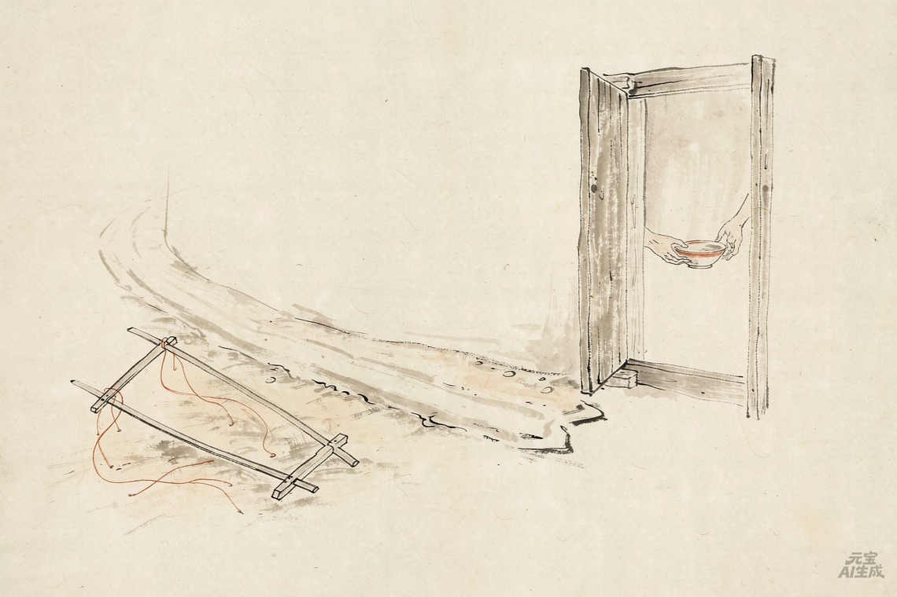

# 第十七课　太上贵德　其次务施报

> 曲礼上 · 一·十八 · 第 17 课

## 一　解题

这一节忽然换了语气：前十六节讲礼之当然，此节讲礼之所从来。它先给两个世道，再给一条规矩，最后给两句断语。

**说什么事**：太上之世贵德，施而不求报；其次之世务施报，礼于是兴。礼尚往来，往不来、来不往皆非礼；人有礼则安，无礼则危，故礼不可不学。礼者自卑而尊人，虽负贩必有尊；富贵好礼则不骄不淫，贫贱好礼则志不慑。

**落在哪一层**：义，兼史。这是全篇唯一一段讲「世变」的文字。

**为何编在此位**：一·十七说人禽之别，划到底线；此节回头说这条线是怎么立起来的——不是天生，是「其次」之世才「礼始兴焉」。

## 二　经文

【经】太上貴德，其次務施報。禮尚往來，往而不來，非禮也；來而不往，亦非禮也。人有禮則安，無禮則危，故曰禮者不可不學也。夫禮者，自卑而尊人，雖負販者，必有尊也，而況富貴乎？富貴而知好禮，則不驕不淫；貧賤而知好禮，則志不懾。

## 三　字义与句读

**太上**　郑注：「太上，帝皇之世，其民施而不惟报。」疏：「太上谓三皇五帝之世也。」「惟，思也」——施而不思其报。

**贵德**　疏：「其时犹淳厚其德，不尚往来之礼，所贵者在于有德。」

**其次**　郑注：「三王之世，礼始兴焉。」疏：「独亲其亲，独子其子，货力为己，施则望报。」

**务施报**　务，专力于此。施则望报，以此为恒事。

**尚往来**　尚，主也。疏：「言三王之世，其礼主尚往来。」

**安、危**　安，相安；危，相侵。礼为相处之器，非为一人之饰。

**自卑而尊人**　卑，自居下位，非自贬；尊人，推高于人。

**负贩**　担货贩卖者。郑注：「负贩者尤轻恌志利，宜若无礼然。」——最像无礼的人。

**骄淫**　骄，慢人；淫，纵己。

**慑**　郑注「慑犹怯惑」；何胤「惮所行为怯」。疏：「贫者之容，好怯惑畏人，使心志不遂。」

## 四　今译

太上之世看重德行，人施与而不思回报；到了其次之世，才专意于施与回报。礼主于往来：往而不来，是非礼；来而不往，也是非礼。人有礼则彼此相安，无礼则彼此相危，所以说礼不可不学。礼这件事，是把自己放低而把人抬高；即使是担货贩卖的人，也有他可尊之处，何况富贵之人？富贵而好礼，就不骄慢不纵欲；贫贱而好礼，心志就不怯惑。

## 五　章旨

礼起于「报」，成于「往来」，用于「安」，而归于「自卑而尊人」。此节四层，一层比一层低，低到负贩者身上，才是礼的实处。

## 六　礼义

**第一层　「施而不惟报」是一种世象，不是一个理想**　郑注只一句「其民施而不惟报」，「惟」训「思」。太上之世不是人人都圣，是那时还不需要算报——施了就施了。疏补一句极准：「其时犹淳厚其德，不尚往来之礼。」不尚，不是不许，是还没到要用礼来维系的地步。读此句最易滑向厚古薄今；其实经文只说「贵德」，未说「贵德者善」。

**第二层　「礼始兴焉」四字的分量**　郑注于「其次务施报」下注：「三王之世，礼始兴焉。」这是全篇最要紧的一条史观：礼不是从德衰后的堕落里生出来的，是从「报」这件事里生出来的。有了施报，才有往来；有了往来，才需要礼。故礼之兴，兴于人事之繁，不兴于人心之坏。今日动辄说「礼崩」，此节正可解：礼从来不曾在「无报」的世道里存在过。

**第三层　两个「非礼」**　「往而不来，非礼也；来而不往，亦非礼也。」四句两两相对，一句也不放过对方。今日多只责前者——我付出了你没回；少责后者——你给了我不要。而后一句其实更常犯：受而不报，等于把对方降为施舍者。礼尚往来之「尚」，正在这一来一往都不许悬空。

**第四层　安危与不可不学**　「人有礼则安，无礼则危。」礼在此不是仪表，是安全设施。一人无礼，危在一身；众人无礼，危在一群。故下一句不说「可学」，说「不可不学」——四字是硬话，不是劝语。

**第五层　自卑而尊人，低到负贩**　全节之纲在此七字。卑不是自贬，是把位置让出来；尊人不是奉承，是承认对方有其可尊。经文随即举一个最极端的例子：负贩者。郑注说得冷：「尤轻恌志利，宜若无礼然。」——最像不讲礼的人，也有其尊。故礼不择人，不因贫富设门槛。

**第六层　一礼治两极**　末二句把礼分给两种人：富贵者病在骄淫，礼治其慢；贫贱者病在慑怯，礼治其怯。同一礼，一头压，一头扶。压的是骄，扶的是志。此节收尾之所以不再说「安」「危」而说「志」，是因为贫者的危不在身，在心。

**与今日何干**　今日论人情往来，多算一头：我给了多少，你回了多少。此节给的是双向账，且把最轻的人也算进去。至于「自卑而尊人」，今日多被读成职场话术；经文原意相反——卑是让位，不是姿态。

## 七　分寸与边界

- **不可**把「太上贵德」做成厚古薄今。经文只说其时「贵德」，未许其民皆善；疏亦只说「不尚往来之礼」。
- **不可**把「其次务施报」做成道德堕落。郑注明言「礼始兴焉」——礼由此兴，非由此坏。
- **不可**把「礼尚往来」做成等价交换。往来所尚者是礼，不是物；报之以礼，非报之以货。
- **不可**只责「往而不来」。后一句「来而不往」同样非礼，且更常犯。
- **不可**把「自卑」做成自轻。卑是让位，让位者自有其位；自轻者已无位可让。
- **不可**把「负贩者必有尊」读成一句客气话。它是全节的落点：礼的适用范围，到最卑处为止，不再往下缩。

## 八　存疑

- **「太上」究指何世**　郑注「帝皇之世」，疏定为「三皇五帝」，并辨郑升「帝」于「皇」上以殊异代。至三皇之数，郑以伏牺、女娲、神农，宋均以燧人、伏牺、神农，《白虎通》以伏牺、神农、祝融，孔安国以伏牺、神农、黄帝，疏断曰「此皆无所据」。本课不列谁为三皇，只取「淳厚之世」之象。
- **「其次」是三王还是三代**　郑注作「三王之世」，疏引「独亲其亲，独子其子，货力为己」，语出《礼运》论三代。本课从郑注，作三王。
- **疏的五级递劣说与经文相抵**　疏自下己意，列道→德→仁→义→礼为五级递劣，末云「此是人情小礼，非大礼也」。而经文于礼却说「安」、说「不可不学」。本课取疏之史观，不取其对礼的贬抑，理由已见六·第二层。
- **「负贩者必有尊」何所尊**　郑注只说其「宜若无礼然」，未言所尊者何。疏则云「于负贩之中，必有所尊」。所尊者是其人、其业、其劳？本课不指实，只作「有其可尊」。
- **「慑」之训**　郑「怯惑」，何胤「惮所行为怯」。一兼心与行，一专指行。本课并存。

## 九　跨典

- 《礼记·礼运》：「今大道既隐，天下为家，各亲其亲，各子其子，货力为己。」——「其次务施报」之底本，疏即引此意。
- 《周易·谦·彖》：「谦尊而光，卑而不可逾。」——「自卑而尊人」之象：卑而不可过，正是让位而不失位。
- 《孝经·广要道章》：「礼者，敬而已矣。」——往来之实不在物，在一敬。
- 《礼记·曲礼上》一·十三：「行修言道，礼之质也。」——往来所尚者礼，礼之质仍在行与言。
- 《礼记·乐记》：「礼者，天地之序也。」——序不在尊卑之名，在往来之不悬空。
- 《礼记·曲礼上》一·十七：「是故圣人作为礼以教人。」——此节之「礼始兴焉」，即彼节「作为」之世。

## 十　双卡

| 左 | 右 |
| --- | --- |
| 太上贵德：施而不惟报 | 其次务施报：三王之世，礼始兴焉 |
| 往而不来，非礼也 | 来而不往，亦非礼也 |
| 人有礼则安 | 无礼则危，故不可不学 |
| 自卑而尊人：负贩亦有尊 | 富贵好礼则不骄淫 |
| 贫贱好礼则志不慑 | 一礼治两极：压骄，扶志 |

## 十一　图

<figure>

<figcaption>图一 · 担搁路左，碗递门右 · lj017a（作者供图）</figcaption>
</figure>

{{fig:lj017b-li-shang-wang-lai|图二 · 礼尚往来：两个非礼 · lj017b}}
