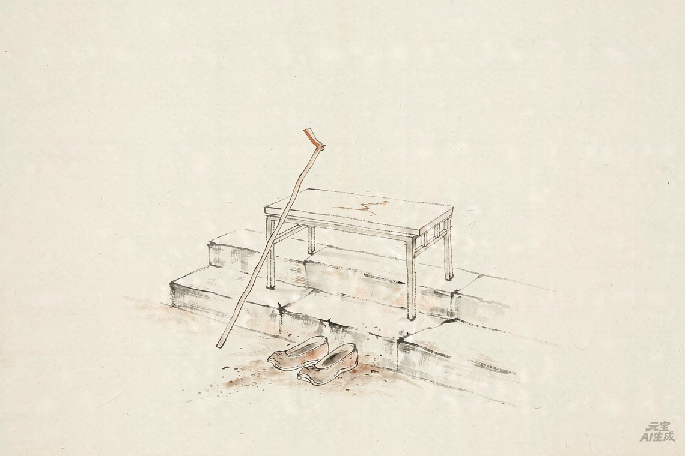

# 第十九课　谋于长者　必操几杖

> 曲礼上 · 一·二十 · 第 19 课

## 一　解题

这一节只两句，是全篇最短的几节之一。但它讲的是求教之礼：前一句说身体要到，后一句说言语要让。

**说什么事**：向长者谋事，必持几杖前往；长者发问，不辞让便作答，是非礼。

**落在哪一层**：教。上一节讲国怎么待老臣，这一节讲人怎么求长者——一套是养，一套是就。

**为何编在此位**：一·十九里有几杖、有老夫、有称名，都是长者的体面；此节把同一副几杖转到少者手里，礼的方向就显出来了。

## 二　经文

【经】謀於長者，必操几杖以從之。長者問，不辭讓而對，非禮也。

## 三　字义与句读

**谋**　求决也，非泛问。所谋者事之疑，须长者断之。

**长者**　年长者也，兼取其德。本篇多以年言，而所尊者不止于年。

**操**　疏：「操，执持也。」

**几杖**　疏：「杖可以策身，几可以杖己，俱是养尊者之物，故于谋议之时将就也。」二物皆所以安长者之身。

**从**　郑注：「从，犹就也。」疏：「将就也。」——不是请长者来，是自己走过去。

**辞让**　先谢己之不敏，而后答。郑注：「当谢不敏，若曾子之为。」

**对**　答也。对之礼在让，不在快。

## 四　今译

向长者谋事，必须持着几杖前往。长者发问，若不辞让就作答，是非礼。

## 五　章旨

求教不是发问，是就；作答不是抢答，是让。身先到，口后开。

## 六　礼义

**第一层　「谋」不是「问」**　问是求知，谋是求决。求决之事，须有人担；故经文不许你把问题抛过去，只许你走过去。一字之别，定了全节的姿态：谋者下，长者上；谋者动，长者静。

**第二层　「操几杖」的分寸**　几、杖皆养身之物。疏说「俱是养尊者之物」，故持之而往，不是送礼，是先把对方能不能坐得住、走得动这件事放在心上。今日求教多带问题，少带几杖：问题一堆，从不问对方此时有没有力气听。此句最实的教训在此。

**第三层　「从，犹就也」**　郑注四个字，是全节的骨。「就」是走过去，是位移。礼的方向由此定：由下而上，由近而远，由己而人。反过来的那种——把长者请来、把问题发过去、等答案自己回来——经文一句「不闻往教」早已堵住（一·十四）。两节合看，礼的方向只有一个。

**第四层　「不辞让而对」为什么是非礼**　郑注说「当谢不敏」。谢不敏不是虚伪的谦辞，它有三个实功：一让出时间，容长者把问说全；二让出位置，承认此题未必由我断；三让出余地，长者之问，或本是引出他自己的话，你若抢答，他的意思就没处放了。故「非礼」二字不是说态度不好，是说这一抢，把「问」的功能抢没了。

**第五层　「若曾子之为」**　郑注举曾子为证，不着一字解释。注家笔法如此：实例放在那里，读者自去礼书中认。曾子之对，见于礼书者多是先自陈不足而后言——这正是「谢不敏」的样子。

**第六层　一台一让**　前句管身，后句管口。身到了，口才不抢；口让了，身才不白到。两句合起来是一件事：求教者先把自己放低，低到对方可以不费力地说话。

**与今日何干**　今日求教多在即时通讯：一句「在吗」，一串问题，等答案。此节只问三件：你到不到，你带不带可坐之物，你先让不让。三件都不做，得到的多是客气话，不是断语。

## 七　分寸与边界

- **不可**把「操几杖」做成送礼。几杖是器物之养，不是财货之馈；送得越重，离「就」越远。
- **不可**把「辞让」做成套话。「谢不敏」之后仍须有「对」；只谢不对，是把问题推回去。
- **不可**把「从之」做成登门即尊。所就从者是长者其人，不是其门第、其位、其名。
- **不可**把「谋」做成请示。谋是求决疑，请示是分责任；前者敬其人，后者避其事。
- **不可**把此节用于上下级话术。经文说的是「长者」，以年德言，不以位言。
- **不可**把「谢不敏」做成自贬。让是让出答的位置，不是让出人的位置。

## 八　存疑

- **几杖是自持以往，还是为长者执之**　郑注「从，犹就也」，疏「将就也」，是持之而往；一说谓既至则为长者执几杖。本课从前说，以后说入存疑。
- **「长者」以年还是以德**　本篇多以年言（一·十九之序即年），而「长者」在后世多兼德言。本课兼取，不专主年。
- **此二句是否专指谋议之时**　疏以此节为「明有事取谋议于长者」，则「不辞让而对」亦在谋议之列，非一切问答之通例。本课从疏。
- **郑注「若曾子之为」所指何事**　疏未明言，礼书中曾子先让后对者不止一处。本课存注文，不指实，免拼合之失。
- **「谋」是否专指国事**　疏未加限。本课作通语：凡疑事求决皆是。

## 九　跨典

- 《礼记·曲礼上》一·十四：「礼闻来学，不闻往教。」——礼的方向只有一头：学者就师，师不往就。
- 《礼记·曲礼上》一·十九：「若不得谢，则必赐之几杖。」——此节几杖之所自：本是君养臣之物，少者持之，是借君之养以养长者。
- 《礼记·学记》：「幼者听而弗问，学不躐等也。」——此节之反面：不当问而问，是躐等；当问而不让，是躐言。
- 《论语·八佾》：「子入太庙，每事问。」——问之礼在于敬，不在于知；与本篇「谋」同其心。
- 《礼记·表记》：「君子不失足于人，不失色于人，不失口于人。」——不失口，即此节之「辞让而对」。
- 《礼记·曲礼上》一·十七：「是故圣人作为礼以教人。」——求教之礼，亦是那套「教」里的一节。

## 十　双卡

| 左 | 右 |
| --- | --- |
| 谋于长者：求决，非求知 | 必操几杖以从之：几杖皆养尊者之物 |
| 从，犹就也：亲往 | 长者问：先谢不敏 |
| 不辞让而对，非礼也 | 身先到，口后开 |
| 来学不往教，方向只一头 | 谢不敏而后有对，不可只谢不对 |

## 十一　图

<figure>

<figcaption>图一 · 阶上几与杖，阶下一双鞋 · lj019a（作者供图）</figcaption>
</figure>

{{fig:lj019b-shen-dao-kou-rang|图二 · 身到，口让 · lj019b}}
