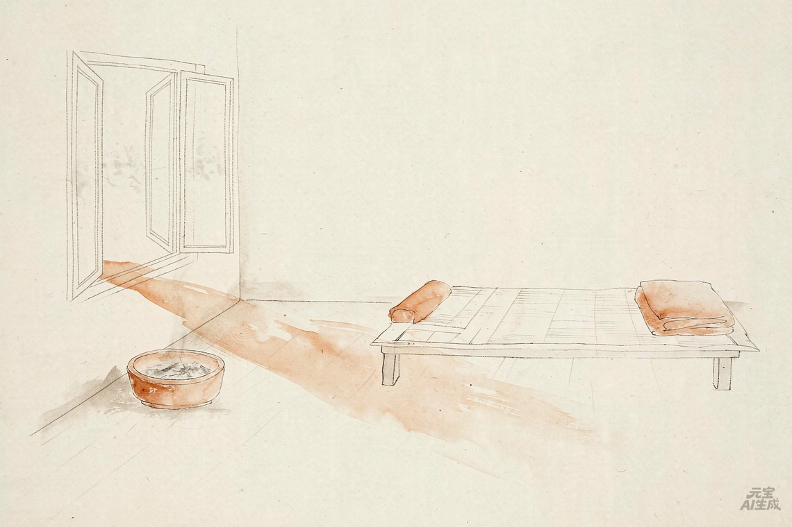

# 第二十课　冬温而夏凊

> 曲礼上 · 一·二十一 · 第 20 课

## 一　解题

这一节只有一句话，八个字，却把「为人子」写成两套功课：一套按四时，一套按一日。

**说什么事**：为人子者，冬则温之，夏则凊之；昏则定之，晨则省之。

**落在哪一层**：教。上一节讲怎么求长者，这一节讲怎么事父母——求教向外，事亲向内，都是「就」。

**为何编在此位**：一·十九讲年至百岁的养道，一·二十讲谋于长者的身与口；此节把「养」落到最具体的两件事上：冷热与起卧。

## 二　经文

【经】凡為人子之禮，冬溫而夏凊，昏定而晨省。

## 三　字义与句读

**凡**　统贵贱而言。疏标此节为「明人子事亲奉养之礼」。

**冬温**　冬寒，则为亲温之。温者，使之暖，非问其寒。

**夏凊**　凊，凉也。陆德明《音义》：「凊，七性反；字从冫，冰，冷也；本或作水旁，非也。」——从冰不从水，是「使之凉」，不是「水之清」。

**昏定**　昏，日入后。郑注：「安定其床衽也。」定者，落在那张床上，不落在嘴上。

**晨省**　晨，旦也。郑注：「省问其安否何如。」

## 四　今译

凡为人子的礼：冬天为父母暖其居处，夏天为父母凉其居处；天黑了替他们安顿床席，天亮了问他们安否。

## 五　章旨

孝之始不在礼物，在体感与时刻。四时管冷热，一日管起卧；两套相合，才盖住一整天。

## 六　礼义

**第一层　「凡」字的分量**　劈头一个「凡」，把这份功课摊给所有为人子者，不问贵贱。礼书讲孝，常被人读成士大夫的教养；此字先把这个读法堵住。

**第二层　「温」「凊」是替他感觉，不是问他感觉**　冬日问一句「冷不冷」，是省；冬日把居处弄暖，是温。经文用的是后者。疏说这是「四时之法」——按季候调，不按问答调。这一层最见分寸：孝不是探询，是代劳；不是收集信息，是改变处境。

**第三层　「定」落在床衽上**　郑注只六字：「安定其床衽也。」不是「问其寝否」，是把床席齐整了，使亲体安定之后才退。疏说得更细：「应卧，当齐整床衽，使亲体安定之后，退。」——退，也是礼的一部分：安顿好了就走，不守着。

**第四层　「省」是隔夜之后的第一眼**　晨省之省，郑注「省问其安否何如」。疏点出一层极易漏掉的意思：「先昏后晨，兼示经宿之礼。」——一夜过去，人才知道昨夜的安顿有没有效。故省不是寒暄，是复查。

**第五层　同宫异宫，礼有变**　熊氏引《内则》：「同宫则鸡初鸣，异宫则昧爽而朝。」住在一处，鸡叫就起身；分宅而居，天将明才去。同一份功课，因距离而改时刻。此条最实用：礼不要求你按一个钟点做，要求你按你与实际处境做。

**第六层　两套并置**　四时之法管寒暑，一日之法管起卧。只有四时，则一日之内无人照看；只有一日，则换季之时无人调停。两套相交，才成一整年、一整天。

**与今日何干**　今日孝多以致敬、转账、节日、礼物表达。此节说的是两件最便宜也最贵的事：替他感觉冷热，按他的作息到场。前者要心细，后者要时间。礼物可以代买，这两样不能代。

## 七　分寸与边界

- **不可**把「温凊」做成伺候。温是调其居处，不是包办其一切；亲体犹在，不可代其生。
- **不可**把「定省」做成打卡。定要落在床衽，省要落在安否；只到场不问事，是行礼的空壳。
- **不可**只做一日不做四时。四时之法最易被忘，因为换季不响铃。
- **不可**把「凡」读成一法通吃。同宫异宫已见其变，贫富、远近、病健，皆当有变。
- **不可**把此节替代医事。温凊是居处之调，不是汤药之治；亲有疾，则礼在《曲礼》下文「亲有疾，饮药，子先尝之」。
- **不可**把此节做成对子女的考核表。经文说的是「为人子之礼」，是自课，不是课人。

## 八　存疑

- **「冬温夏凊」有无郑注**　今本郑注于此前半只注「昏定晨省」，冬温夏凊之义全在疏（「四时之法」）。本课据疏立说，不托郑。
- **「凊」的字形**　陆德明辨「字从冫，冰，冷也；本或作水旁，非也」。今多写作「凉」义而字形从水，非其旧。本课从《音义》。
- **「定」是安床衽还是安心**　郑注明作「安定其床衽」，疏亦以齐整床衽为说。后世有解为「定其心者」，非注本义。本课从注。
- **「省」是视还是问**　郑注「省问其安否何如」，兼视与问。本课并存，不专主问。
- **同宫异宫之时**　熊氏引《内则》鸡初鸣、昧爽而朝，是士之常；天子诸侯大夫各有早晚，礼书别见。本课只取「礼因距离而变」之义。

## 九　跨典

- 《礼记·内则》：「子事父母，鸡初鸣，咸盥漱……」——此节「晨省」之实，《内则》是它的日程表。
- 《礼记·祭义》：「孝子之有深爱者，必有和气；有和气者，必有愉色；有愉色者，必有婉容。」——温凊定省是外，和气愉色是内；无内则外为仪。
- 《孝经·纪孝行章》：「孝子之事亲也，居则致其敬，养则致其乐，病则致其忧。」——「居」与「养」二事，正此节所司。
- 《论语·为政》：「父母唯其疾之忧。」——定省所省者，正是此「忧」。
- 《礼记·曲礼上》一·十九：「百年曰期，颐。」——此节是「颐」的日常做法。
- 《礼记·曲礼上》一·二十：「谋于长者，必操几杖以从之。」——对外则就，对内则定省，礼只是一路「就」。

## 十　双卡

| 左 | 右 |
| --- | --- |
| 四时：冬温 | 四时：夏凊 |
| 一日：昏定（安床衽） | 一日：晨省（问安否） |
| 温者使之暖，非问其寒 | 定者落在床衽，不落在嘴上 |
| 先昏后晨，示经宿之礼 | 同宫鸡鸣，异宫昧爽 |

## 十一　图

<figure>

<figcaption>图一 · 一窗一床，斜光自窗及席 · lj020a（作者供图）</figcaption>
</figure>

{{fig:lj020b-si-shi-yi-ri|图二 · 四时与一日 · lj020b}}
