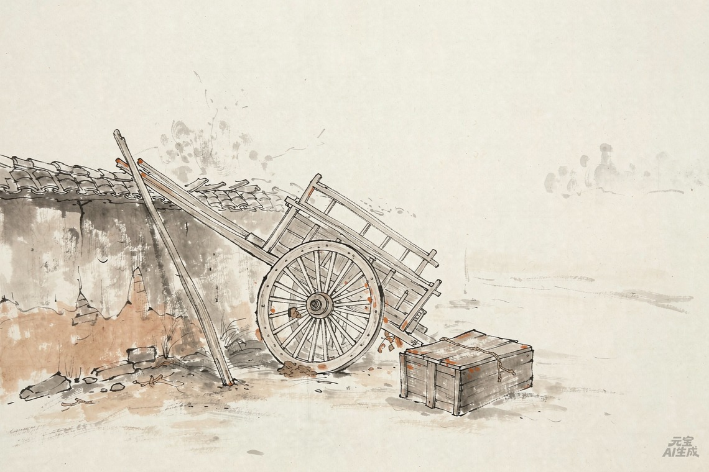

# 第二十一课　三赐不及车马

> 曲礼上 · 一·二十二 · 第 21 课

## 一　解题

这一节分两半：前半讲一样东西不肯受，后半讲五个地方都说他好。两半其实是一件事——孝子的样子，先从「减」上现出来。

**说什么事**：为人子者，受三命之赐而独不及车马；故州闾乡党称其孝，兄弟亲戚称其慈，僚友称其弟，执友称其仁，交游称其信；见父之执，不谓之进不敢进，不谓之退不敢退，不问不敢对。此孝子之行也。

**落在哪一层**：教。上一节讲在内如何事亲，这一节讲在外如何被人看。

**为何编在此位**：温凊定省是门内的功课，三赐五称是门外的样子。礼先立内，再及外；而外的第一条，竟是「不受」。

## 二　经文

【经】夫為人子者，三賜不及車馬。故州閭鄉黨稱其孝也，兄弟親戚稱其慈也，僚友稱其弟也，執友稱其仁也，交遊稱其信也。見父之執，不謂之進不敢進，不謂之退不敢退，不問不敢對，此孝子之行也。

## 三　字义与句读

**夫**　疏：「言『夫』者，贵贱悉然也。」发语词，统一切为人子者。

**三赐**　郑注：「三赐，三命也。」一命而受爵，再命而受衣服，三命而受车马。

**不及**　疏辨此二字最细：「不云『不受』，而云『不及』者，受是已到之日，明人子非唯外迹不受，抑亦心所不及于此赐也。」

**州闾乡党**　地缘之最近者。二十五家为闾，五百家为党，乡则更大。

**慈**　疏：「亲指族内，戚言族外。慈者，笃爱之名。」

**弟**　同「悌」，顺也。僚友，同官者。

**执友**　郑注：「执友，执志同者也。」疏：「同师之友，意趣相得，绸缪切瑳。」

**交游**　疏：「结交游往，本资信合，故称信也。」

**见父之执**　郑注：「敬父同志，如事父。」疏：「自上诣下曰见，自下朝上曰见。」——「见」字双向，来亦见，往亦见。

## 四　今译

为人子者，受三命之赐，独不到车马这一样。所以州闾乡党称他孝，兄弟亲戚称他慈，僚友称他悌，执友称他仁，交游称他信。见到父亲的同志，不叫他进不敢进，不叫他退不敢退，不问就不敢答——这就是孝子的行止。

## 五　章旨

孝的验不在自己身上，在别人口里；而验的最先一处，是有一样东西他偏偏不受。

## 六　礼义

**第一层　三赐即三命**　郑注一句「三赐，三命也」，把「赐」落到命数上。一命受爵、再命受服、三命受车马——按《周礼》九仪，一级一级往上。故此处不是泛说赏赐，是说一个已经走到第三级的人。

**第二层　「不及」二字**　疏辨得最狠：不说「不受」，说「不及」。受，是东西已经到手的那一天；不及，是心里根本没往那里去。前者是行为上的推辞，后者是念头上没有伸手。礼书用一字，把「辞让」从动作推进到心里。

**第三层　命可受而车马不可受**　疏的解释极准：命是荣美，「光显祖父」，故受；车马是安身，「身安不关先祖」，故不受。同是三命所赐，一样连着祖先，一样只连着自己。孝子的界线就画在这里：凡使祖先有光的，受；凡只使自己舒服的，不受。

**第四层　五称是一圈一圈收窄的**　州闾乡党、兄弟亲戚、僚友、执友、交游——从地缘到血亲，到同官，到同道，到泛交。熊氏说这五句「上始州闾，下及交游，亦其次也」。而所许之德也随之转：孝对亲，慈对族，弟对同列，仁对同道，信对泛交。五种人称他五种德，没有一种可以互相代替——你无法让交游称你孝。

**第五层　「见」字双向**　疏说「自上诣下曰见，自下朝上曰见」。父之执来，你去见；你去，也是见。故这一节的敬是双向的：他来了，你的进退要等他一句话；你去了，你的进退也一样。三「不敢」不是怯，是把主动权整个交出去。

**第六层　两半合看**　前半是「不受」，后半是「不敢」。一个减其所当得，一个减其所当行。孝子在外的样子，全由减法做成：少一样车马，少一步路，少一句话。

**与今日何干**　今日讲人设、讲口碑、讲「别人怎么看我」。此节的五称统统不是自设的：称由人称，且各有其域。你能做的是把自己那一份减下来，让五种人在五个位置上各自看得出一样东西。

## 七　分寸与边界

- **不可**把「不及车马」做成清高姿态。所不受者车马，非一切荣；命仍受，爵仍受。
- **不可**把「五称」做成目标管理。五称是别人给的评语，不是自己列的 KPI；一追求，即失。
- **不可**把五称混为一德。孝、慈、弟、仁、信各有其域，越域而求，则五样皆虚。
- **不可**把三「不敢」做成没主见。所不敢者是进退与答，非不敢言事、不敢谏过。
- **不可**把「如事父」做成谄。所敬者是父之同志，敬的是那份「同志」，不是其位。
- **不可**把此节读成门第论。疏已明言「言夫者，贵贱悉然」。

## 八　存疑

- **三赐是否即三命**　郑注明言「三赐，三命也」；而疏引《周礼》九仪作「三命受位」，注文却作「受车马」。二文小异。本课从郑注，九仪之文入存疑。
- **「不及」是心不及还是迹不受**　疏兼二者：「非唯外迹不受，抑亦心所不及」。本课从疏，两存而不偏。
- **五称有无次第**　熊氏以为「上始州闾，下及交游，亦其次也」；亦有以为泛举五者、不必次第。本课从熊氏，取其圈层之义。
- **僚友与执友之别**　执友是「执志同者」，僚友是同居一官者。一以志合，一以位合。本课依注分列，不混。
- **「见」字双向**　疏「自上诣下曰见，自下朝上曰见」，是同字两向。本课存疏说。

## 九　跨典

- 《周礼·春官·大宗伯》九仪：「一命受职，再命受服，三命受位，四命受器……」——三赐之制所本，疏已引。
- 《论语·学而》：「孝弟也者，其为仁之本与。」——五称之中，孝、弟、仁三字，此语一线贯之。
- 《礼记·曲礼上》一·二十：「谋于长者，必操几杖以从之。」——「见父之执」三不敢，与此节同一「就」字。
- 《礼记·曲礼上》一·二十一：「冬温而夏凊，昏定而晨省。」——门内之事；此节门外之容。内外各有一半。
- 《礼记·冠义》：「凡人之所以为人者，礼义也。」——五称所归，仍是此一句。

## 十　双卡

| 左 | 右 |
| --- | --- |
| 三赐：命受，光显祖父 | 车马不受：安身不关先祖 |
| 不云不受，云不及 | 外迹不受，心亦不及 |
| 州闾乡党称其孝 | 兄弟亲戚称其慈 |
| 僚友称其弟 | 执友称其仁；交游称其信 |
| 见父之执，三不敢 | 敬父同志，如事父 |

## 十一　图

<figure>

<figcaption>图一 · 卸马车倚墙，箱有旧绳痕 · lj021a（作者供图）</figcaption>
</figure>

{{fig:lj021b-yi-zi-wu-mian|图二 · 一子五面 · lj021b}}
