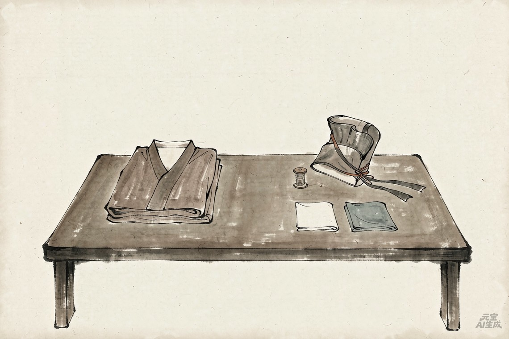

# 第二十四课　冠衣不纯素

> 曲礼上 · 一·二十五 · 第 24 课

## 一　解题

这一节讲衣裳的颜色：父母在，冠与衣的镶边不用纯白；失了父的孤子当家，镶边不用彩色。一节两句，一句是「不敢素」，一句是「不敢采」。

**说什么事**：为人子者，父母存，冠衣不纯素；孤子当室，冠衣不纯采。

**落在哪一层**：教。上节讲出入与行事，这节讲身上穿的颜色——礼细到一根镶边。

**为何编在此位**：一·二十四从门槛出去，此节回到身上：人还没出门，衣服先说话。

## 二　经文

【经】為人子者，父母存，冠衣不純素。孤子當室，冠衣不純采。

## 三　字义与句读

**纯**　郑注：「纯，缘也。」疏：「冠纯谓冠饰也，衣纯谓深衣领缘也。」——「纯」不是整件颜色，是镶边。

**不纯素**　郑注：「为其有丧象也。」素是丧色，亲在而以素缘，是拿丧色自处。

**等次**　疏：「《礼》，具父母、太父母存，冠衣纯以缋；若有父母，无太父母，则纯以青；若少而并无，则乃纯素也。」

**孤子**　郑注：「早丧亲，虽除丧，不忘哀也。谓年未三十者。三十壮，有室，有代亲之端，不为孤也。」

**当室**　郑注：「当室，適子也。《深衣》曰：『孤子衣纯以素。』」

## 四　今译

做人家儿子的，父母在，冠与衣的镶边不用纯白。失了父而承家的孤子，冠与衣的镶边不用彩色。

## 五　章旨

一节两句，其实是一句话的两头：颜色记着亲在不在。亲在，不敢用丧色；亲不在而年少，不忍用吉色。礼不在衣上，在衣上那一道窄边上。

## 六　礼义

**第一层　素是丧色，亲在不敢自处丧**　郑注四字：「为其有丧象也。」穿什么不是审美，是身份宣告。父母在而衣纯素，等于对外说「我家有丧」。

**第二层　镶边有等，礼用颜色记亲之存否**　疏把等次排开：父母、祖父母俱在，纯以缋（彩）；有父母而无祖父母，纯以青；少而皆无，乃纯素。三代存否，一根镶边分出三档——这是礼最经济的记事法：不必问，看衣便知。

**第三层　孤子不纯采：不是不许他吉，是哀不许**　郑注定得极严：「谓年未三十者。三十壮，有室，有代亲之端，不为孤也。」三十是界：未三十而失父，虽已除服，仍不作吉色；过了三十，有妻有室，能代亲承事，便许其采。

**第四层　「不言凡」的分寸**　疏一句要紧：「不言凡者，若仕者或遇凶荒，虽亲存亦须素服，非要在亲没，故不言凡。」——所以这不是通则，是有例外的常礼；礼自己留了门。

**与今日何干**　今日穿衣只看场合，不看亲。此节提醒：身上有颜色，颜色会说家里的事。今日不必素缘青缘，但「不以丧色自处于亲在之日」，这层意思还站得住。

## 七　分寸与边界

- **不可**把「不纯素」做成通身禁白。所禁者是镶边之纯素，非白色一概不用。
- **不可**把「纯」当成整件衣色。郑训「纯」为「缘」，所论者在边。
- **不可**把孤子之素推及于冠。《深衣》只言衣，疏亦云「不言冠者，从可知」，本课不推。
- **不可**把三十之界当成铁律。郑以「有代亲之端」为断，其意在能否承家，不在岁数本身。
- **不可**把此节读成服丧条例。所言者是平居之服，非丧服制度。

## 八　存疑

- **「纯」是缘还是全**　郑训「缘」，而后世有解作全色者。本课从郑。
- **三十之界何据**　郑以「壮、有室、有代亲之端」为断；若三十而未娶者如何，注无明文。本课存疑。
- **「当室」是否专属適子**　郑云「適子」，疏引崔灵恩谓「不当室则纯采」；又引《深衣》「孤子衣纯以素」似通庶子。二说并存。
- **「不言凡」的范围**　疏举凶荒仕者为例，此外尚有他例否，注未列。本课只存疏说。
- **缋、青、素三等的礼据**　疏引自《礼》与《深衣》，其全文今不尽见，本课只录疏文，不补。

## 九　跨典

- 《礼记·玉藻》：「缟冠玄武，子姓之冠也。」「缟冠素纰，既祥之冠也。」——郑注引以证冠有吉凶之别。
- 《礼记·深衣》：「具父母，衣纯以青。」「孤子衣纯以素。」——镶边等次之据。
- 《礼记·内则》：「二十……可以衣裘帛。」——与下节「童子不衣裘裳」相承。
- 《礼记·曲礼上》一·二十四：「出必告，反必面。」——上节管行止，此节管衣服，同是使亲可知。

## 十　双卡

| 左 | 右 |
| --- | --- |
| 父母存，冠衣不纯素 | 为其有丧象也 |
| 纯，缘也 | 冠纯为冠饰，衣纯为领缘 |
| 俱存纯以缋，有父母纯以青 | 少而并无，乃纯素 |
| 孤子当室，冠衣不纯采 | 年未三十，虽除丧不忘哀 |
| 三十壮有室，有代亲之端 | 不为孤 |

## 十一　图

<figure>

<figcaption>图一 · 冠衣叠件，领缘不与素同 · lj024a（作者供图）</figcaption>
</figure>

{{fig:lj024b-su-cai-liang-duan|图二 · 素与采：两端之让 · lj024b}}
