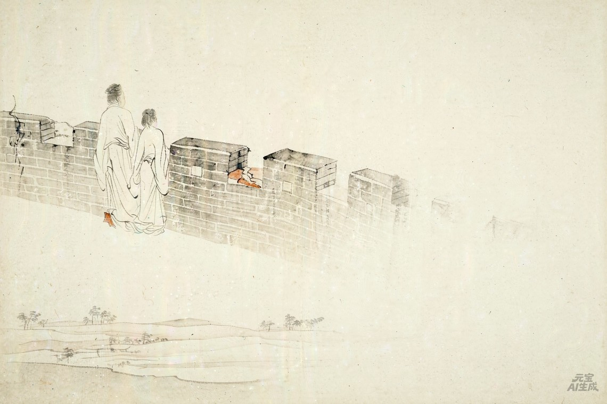

# 第二十七课　登城不指，城上不呼

> 曲礼上 · 一·二十八 · 第 27 课

## 一　解题

这一节讲在高处：跟长者上丘陵，眼要随长者所看；登上城墙不随手乱指，在城上不大声呼喊。

**说什么事**：从长者而上丘陵，则必乡长者所视；登城不指，城上不呼。

**落在哪一层**：教。上节在平地路上，这节登上高处——地一高，眼与口都容易放肆。

**为何编在此位**：一·二十七讲随行，此节讲随行到高处；同是「从」，一处看脚，一处看眼。

## 二　经文

【经】從長者而上丘陵，則必鄉長者所視。登城不指，城上不呼。

## 三　字义与句读

**乡长者所视**　郑注：「为远视不察有所问。」——上到高处，长者必有远望；你眼不随他，他一旦有问，你答不上。

**不指**　郑注：「为惑人。」——手指一伸，众人跟着看，指错即导错。

**不呼**　郑注：「为惑人。」疏：「呼，号叫也。」

**视随的实法**　疏：「长者东视则东视，长者西视则西视，从先生君子亦然。」

## 四　今译

跟着长者登上丘陵，一定要朝长者所看的方向看。登上城墙不可随意指点，在城上不可高声呼喊。

## 五　章旨

一句「随视」，两句「禁口手」。高处使人心易放：眼要放远，故不许自作主张看别处；手要指，口要喊，故先禁住。礼在高处，管的是视野与声音。

## 六　礼义

**第一层　随视不是跟风，是备问**　郑注一句实在：「为远视不察有所问。」——上高处是为了看远，长者看远必有所见，也必有所问。你眼若在他处，他一问，你只能哑。所以随视是「预备回答」，不是陪看风景。

**第二层　「不指」禁的是「代长者指」**　城上人多，一指则众目随指而动。指错一处，众人便错看一处；这在城上不是小事：望敌、望火、望行人，一指之差，众人皆误。故注只说两字「惑人」。

**第三层　「不呼」禁的是「以声乱众」**　呼与指同罪，理由也是「惑人」。城上本是警备之地，一声号叫，远近皆惊，以为有变。

**第四层　一条通则：高处是三样失礼最易犯的地方**　眼易游、手易指、口易呼。礼在此不是管风景，是管「公共视野」。今日的公共场合——天台、讲台、直播镜头——同理：你指一下、喊一声，别人的注意力就被你牵走了。

**与今日何干**　今日看展、看景、看热闹，人人举指、处处呼叫。此节给的规矩很旧也很新：与长辈同看，眼随他；在公共高处，手不指、口不呼。所省者不是兴致，是别人的误判。

## 七　分寸与边界

- **不可**把「必乡长者所视」做成不得看别处。所随者是长者所视，非禁你转头。
- **不可**把「不指」做成不许说明。口说「在那边」而不举指，礼所不禁。
- **不可**把「不呼」做成不许出声。所言者号叫，非低声问答。
- **不可**把此节只当出门在外之礼。城上者，公地也；其义可通于一切公共高处。
- **不可**把「惑人」解成「怕人看见」。所惑者是众人的判断，不是隐情。

## 八　存疑

- **「丘陵」是否专指高处**　注疏皆以「远视」为说，则所重在高，不在地形之名。本课从注。
- **「不指」所指者何**　注只言「惑人」，未分指人、指物、指方向。本课不补。
- **「城上不呼」是否兼指夜间警备**　注无明文，疏亦不言。本课只就常礼说。
- **长者所视，若你不识其物如何**　注疏皆不言。本课存疑。
- **此节与「不登高」如何协调**　一·二十三有「不登高」，此节却从长者上丘陵。本课以「从长者」为条件解之：非自往，从命而行。

## 九　跨典

- 《礼记·曲礼上》一·二十三：「不登高，不临深。」——彼为避危，此为从命；一禁一许，条件不同。
- 《礼记·曲礼上》一·二十七：「从于先生，不越路而与人言。」——同为「从」，彼禁分心于路，此禁分眼于高。
- 《礼记·曲礼上》一·二十四：「五年以长，则肩随之。」——随行的礼，正为此节之基。

## 十　双卡

| 左 | 右 |
| --- | --- |
| 从长者而上丘陵 | 为远视不察有所问 |
| 必乡长者所视 | 长者东视则东视，西视则西视 |
| 登城不指 | 为惑人 |
| 城上不呼 | 为惑人 |

## 十一　图

<figure>

<figcaption>图一 · 堞后望远，半步随后 · lj027a（作者供图）</figcaption>
</figure>

{{fig:lj027b-yan-sui-shou-jin|图二 · 眼随手禁：一随二禁 · lj027b}}
