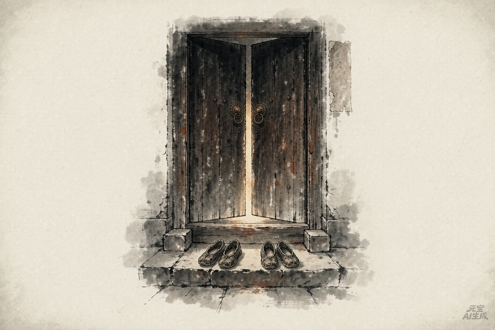

# 第二十八课　将适舍，求毋固

> 曲礼上 · 一·二十九 · 第 28 课

## 一　解题

这一节讲做客入门的一串动作：投宿不求必得；上堂先扬声；门外有两双鞋，听见说话才进；进门眼要向下，手如奉扃；门开随开、门闭随闭；后有来人，关门别关死；不踩人鞋，不跨席，提衣走到席角；应答要谨慎。

**说什么事**：将适舍，求毋固；将上堂，声必扬；户外有二屦，言闻则入，言不闻则不入；将入户，视必下；入户奉扃，视瞻毋回；户开亦开，户阖亦阖；有后入者，阖而勿遂；毋践屦，毋踖席，抠衣趋隅，必慎唯诺。

**落在哪一层**：教。上节在高处，这一节落到别人家门口——礼最密的一段。

**为何编在此位**：一·二十七、二十八讲在外随行，此节转入「做客」；从路上到门内，一步比一步细。

## 二　经文

【经】將適舍，求毋固。將上堂，聲必揚。戶外有二屨，言聞則入，言不聞則不入。將入戶，視必下。入戶奉扃，視瞻毋回。戶開亦開，戶闔亦闔。有後入者，闔而勿遂。毋踐屨，毋踖席，摳衣趨隅，必慎唯諾。

## 三　字义与句读

**求毋固**　郑注：「谓行而就人馆。固犹常也。求主人物，不可以旧常致时乏无。」疏：「适犹往也。舍，主人家也……不可责求于主人，责常旧有之物。」

**声必扬**　郑注：「警内人也。」——先让屋里知道有人来。

**户外有二屦**　郑注：「不于掩人之私也。」疏：「此谓两人体敌，故二屦在外」；熊氏：「户外有二屦，则三人也」，引下文「离坐离立，无往参焉」为证。

**奉扃**　郑注：「奉扃，敬也。」疏：「今关户之木，与关鼎相似，亦得称扃……今入户虽不奉扃木，其手若奉扃然。」——手当心而捧，如捧门闩。

**视瞻毋回**　疏：「初将入时视必下，而竟不得回转，广有瞻视也。」

**户开亦开，户阖亦阖**　疏：「不以后来变先。」**阖而勿遂**　郑注：「示不拒人。」

**趋隅**　郑注：「趋隅，升席必由下也。」疏：「当两手提裳之前，徐徐向席之下角，从下而升。」

**必慎唯诺**　郑注（疏引）：「不先举，见问乃应。」——不先开口。

## 四　今译

要去人家投宿，求物不可固执按旧例。将要上堂，先扬声告知。门外有两双鞋，听见里面说话才进，听不见说话就不进。将要进门，眼必向下。进门时手如捧扃，目光不可回转。门原开着就随它开着，原关着就随它关着。后面还有人要进，关门不必关死。不踩别人的鞋，不跨过席子，提起衣裳走到席的下角，应答务必谨慎。

## 五　章旨

一节的骨是「不掩人之私」：声扬、视下、不回、随开随阖、勿遂、慎唯诺——每一句都在防「撞见」与「惊动」。做客的礼，核心不是客气，是不侵入。

## 六　礼义

**第一层　求毋固：不把主人的旧例当成应得**　郑注说得清楚：「不可以旧常致时乏无。」你上次来有某物，这次未必有；不可拿旧例逼人。疏更直：「不可责求于主人。」

**第二层　声扬与二屦：进门前的两次确认**　声扬是「警内人」，让对方有机会整理；二屦是「观其数」：门外两双鞋，屋里便有两人，两人密语，你便不该闯。疏引熊氏一说，谓户外二屦其实是三人——数目之争虽未定，「先看再进」的规矩是定的。

**第三层　视下与不回：眼是最会犯礼的地方**　疏：「恐睹人私，故必下」；入了门还「不得回转，广有瞻视」。礼在这里不是要你闭眼，是要你「看一眼脚下，别转一圈」。

**第四层　随开随阖、勿遂：不以后来变先，也不拒后来**　原样不动，是尊先来者之意；关门留缝，是给后来者留路。一句之内，兼顾前后——这是礼最见分寸的地方。

**第五层　趋隅与慎唯诺：入席的走法与开口的时机**　升席必由下角，是从卑处上，不从正面横穿；「不先举，见问乃应」，是等问再答。做客的全部体面，就在这两件小事上。

**与今日何干**　今日串门、进办公室、进会议室，多是推门就进、坐下就说话。此节的六条，几乎可以照抄成今日的「进门前一分钟」。

## 七　分寸与边界

- **不可**把「求毋固」做成不敢开口。所禁者是按旧例强索，不是不许提出请求。
- **不可**把「声必扬」做成高声喧叫。警内人而已，非喊门。
- **不可**把「二屦」读成硬数目。注疏本有二人、三人二说，所重者在「先察后入」。
- **不可**把「视必下」做成一路低头。疏只言入门之时及不得回转。
- **不可**把「阖而勿遂」做成不关门。所禁者是关死拒人。

## 八　存疑

- **「户外有二屦」是二人还是三人**　郑以二屦当二人，熊氏据「离坐离立毋往参」推为三人。本课两存。
- **「奉扃」是实捧门闩还是拟态**　郑注只言「敬也」，疏明言「虽不奉扃木，其手若奉扃然」。本课从疏。
- **「毋踖席」之「踖」**　注疏解为跨席、蹑席，字有异文。本课从「跨」义。
- **「必慎唯诺」是否兼指不轻诺**　郑以「不先举，见问乃应」为说，重在时机；后世兼取「不轻许」义。本课从郑。
- **此节是否专指士相见之礼**　疏以「为宾客礼」为说，未限身份。本课作通礼看。

## 九　跨典

- 《礼记·少仪》：「排阖脱屦于户内者，一人而已矣。」——疏引，证尊卑不同则脱屦之处不同。
- 《礼记·曲礼上》一·三十：「凡与客入者，每门让于客。」——此节是客入门，下节是主迎客，一客一主，合为一礼。
- 《礼记·曲礼上》一·三十一：「帷薄之外不趋。」——入室之后的走法，紧接此节。
- 《礼记·曲礼上》一·十四：「礼闻来学，不闻往教。」——同是不侵入他人之地。

## 十　双卡

| 左 | 右 |
| --- | --- |
| 将适舍，求毋固 | 不可以旧常致时乏无 |
| 将上堂，声必扬 | 警内人也 |
| 户外有二屦，言闻则入 | 不于掩人之私也 |
| 将入户，视必下 | 恐睹人私 |
| 入户奉扃，视瞻毋回 | 手若奉扃，不得回转 |
| 户开亦开，户阖亦阖 | 不以后来变先 |
| 有后入者，阖而勿遂 | 示不拒人 |
| 抠衣趋隅，必慎唯诺 | 升席必由下；不先举，见问乃应 |

## 十一　图

<figure>

<figcaption>图一 · 门外双屦，一线灯影 · lj028a（作者供图）</figcaption>
</figure>

{{fig:lj028b-ru-men-liu-bu|图二 · 入门六步：先察后入 · lj028b}}
