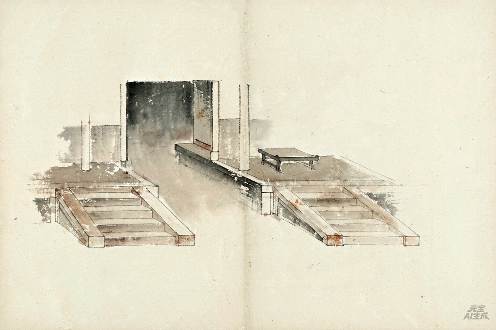

# 第三十课　每门让于客

> 曲礼上 · 一·三十一 · 第 30 课

## 一　解题

这一节讲主人迎客入门的全套：每过一门让客先行；客人到内门，主人先入布席再出迎；客再三辞，主人引进；主人入门向右、客向左；主人就东阶、客就西阶；客若位卑则就主人之阶，主人固辞才归西阶；登阶互让，主人先登客随后，拾级聚足、连步而上；上东阶先出右脚，上西阶先出左脚。

**说什么事**：凡与客入者，每门让于客；客至于寝门，则主人请入为席，然后出迎客；客固辞，主人肃客而入；主人入门而右，客入门而左；主人就东阶，客就西阶；客若降等，则就主人之阶，主人固辞，然后客复就西阶；主人与客让登，主人先登，客从之，拾级聚足，连步以上；上于东阶则先右足，上于西阶则先左足。

**落在哪一层**：教。上节是臣入君门的一条线，这节是宾主入门的一整套。

**为何编在此位**：一·二十九言臣，一·三十言宾主；位分既明，进退之节才立。

## 二　经文

【经】凡與客入者，每門讓於客。客至於寢門，則主人請入為席，然後出迎客。客固辭，主人肅客而入。主人入門而右，客入門而左。主人就東階，客就西階。客若降等，則就主人之階。主人固辭，然後客復就西階。主人與客讓登，主人先登，客從之，拾級聚足，連步以上。上於東階則先右足，上於西階則先左足。

## 三　字义与句读

**每门让于客**　郑注：「下宾也。敌者迎于大门外。《聘礼》曰：『君迎宾于大门内。』」疏：「天子五门，诸侯三门，大夫二门。」

**请入为席**　郑注：「为犹敷也，虽君亦然。」疏：一为自谦，不敢逆设席以招贤；二为重慎，更宜视之。

**客固辞**　郑注：「又让先入。」疏：「礼有二辞，初曰礼辞，再曰固辞，三曰终辞。」

**肃客**　郑注：「肃，进也。进客谓道之。」

**入门而右、而左**　郑注：「右就其右，左就其左。」

**客若降等**　郑注：「降，下也。谓大夫于君，士于大夫也，不敢辄由其阶，卑统于尊，不敢自专。」

**固辞复西阶**　郑注：「复其正。」

**拾级聚足**　郑注：「拾当为涉，声之误也。级，等也。涉等聚足，谓前足蹑一等，后足从之并。」

**连步**　郑注：「重蹉跌也。连步谓足相随不相过也。」

**先右足、先左足**　郑注：「近于相乡敬。」

## 四　今译

凡与客人一同进门，每过一门都让客人先走。客人到了内门，主人先请入内铺席，然后出来迎客。客人再辞，主人便引进门。主人进门靠右，客人进门靠左；主人走向东阶，客人走向西阶。客人若位卑，就走向主人的阶；主人再三辞，客人才回到西阶。主人与客人互相让登，主人先上，客人跟着；一级一顿、两脚相并而上，连步不停。上东阶先出右脚，上西阶先出左脚。

## 五　章旨

一节五让：让门、让入、让阶、让登、让足。让到「先出哪只脚」这一步，已不是礼貌，是把对方的尊位落到身体的动作里。

## 六　礼义

**第一层　每门让：让的是「先」**　疏解「下宾」：主人自处于下。一道门让一次，几道门便让几次——不是让一次意思到了就算，而是每一处都重新让。礼的重复不是啰嗦，是不许你「让过就忘」。

**第二层　请入为席：主人先离场再出场**　客已到内门，主人却先入内铺席，再出来迎。疏说二义：自谦（不敢预设席等人）、重慎（再看一遍）。这一进一出，是把「准备」藏起来，不让客人看见忙乱。

**第三层　入门右左、就东西阶：方位即是位分**　主右客左、主东客西，各就其位，一人一条线。疏说「右就其右，左就其左」——不是谁尊谁卑的问题，是各归各位，谁也不越到对方那条线上。

**第四层　降等就主阶、固辞复西阶：卑者不敢自专**　位卑之客先要随主人之阶，主人固辞，客才归西阶。这一让一辞，是「卑统于尊，不敢自专」的实演：先自下，待主人推回来，才受。

**第五层　拾级聚足、连步：速度里的敬**　郑注解「涉等聚足」：前脚踏一级，后脚并上来；「连步」：足相随而不相过。上阶不是登，是「跟着上」。疏又说主人先升至第二级，客乃升，中较一级。一阶之间的空，就是敬。

**第六层　先右足、先左足：最后一寸的让**　郑注四字「近于相乡敬」：东阶在西、西阶在东，各以近于对方的那只脚先上，身体自然向对方略侧。让到这里，已无可再让。

**与今日何干**　今日迎客多在门口等着、一路并行。此节给的次序可以照用：先让门，再让位，再让先，最后连脚步都略后一点。真正的待客，不在话多，在「先」字上让得干净。

## 七　分寸与边界

- **不可**把「每门让」做成不敢进门。让是次序，不是推诿到底。
- **不可**把「请入为席」做成把客人晾在门外。疏明言入铺席竟即出迎。
- **不可**把「降等就主阶」做成自贬。所以然者，是不敢自专，主人固辞便归西阶。
- **不可**把「主人先登」做成抢先。疏明言让必以三，三竟客不从，主人才先。
- **不可**把「先右足」当成左右脚迷信。注以「相乡敬」为说，取其向对方。

## 八　存疑

- **「每门」的门数**　疏举天子五门、诸侯三门、大夫二门，然经文为通礼，具体门数随等。本课只取「每门皆让」之义。
- **「敌者迎于大门外」与「君迎宾于大门内」**　郑注并举二礼，依宾主是否敌体为别。本课存二说。
- **「拾级聚足」的步法**　郑读「拾」为「涉」，与通行读「拾」者不同。本课从郑。
- **「客若降等」所降者何**　郑举「大夫于君、士于大夫」为例，疏又引《聘礼》《公食大夫礼》异文。范围未定，本课从郑例。
- **「上于东阶则先右足」的方位**　注只言「相乡敬」，疏未详其面。本课不补。

## 九　跨典

- 《仪礼·聘礼》：「君迎宾于大门内。」——郑注引，证不敌者之迎。
- 《礼记·曲礼上》一·二十九：「将上堂，声必扬。」——客入门之节，与此节主迎客相接。
- 《礼记·乡饮酒义》：「主人席阼阶上西面，介席西阶上东面。」——东西阶之位分，见于礼席。
- 《礼记·曲礼上》一·二十三：「立不中门。」——同以门中为尊者之地。

## 十　双卡

| 左 | 右 |
| --- | --- |
| 每门让于客 | 下宾也；敌者迎于大门外 |
| 请入为席，然后出迎 | 为犹敷也；自谦且重慎 |
| 主人入门而右，客入门而左 | 右就其右，左就其左 |
| 主人就东阶，客就西阶 | 各归其位，一人一线 |
| 客若降等，则就主人之阶 | 卑统于尊，不敢自专 |
| 主人固辞，客复就西阶 | 复其正 |
| 拾级聚足，连步以上 | 前足蹑一等，后足从之并 |
| 上东阶先右足，上西阶先左足 | 近于相乡敬 |

## 十一　图

<figure>

<figcaption>图一 · 两阶分列，堂上只一几 · lj030a（作者供图）</figcaption>
</figure>

{{fig:lj030b-wu-rang-zhi-xu|图二 · 五让之序：门、席、阶、登、足 · lj030b}}
