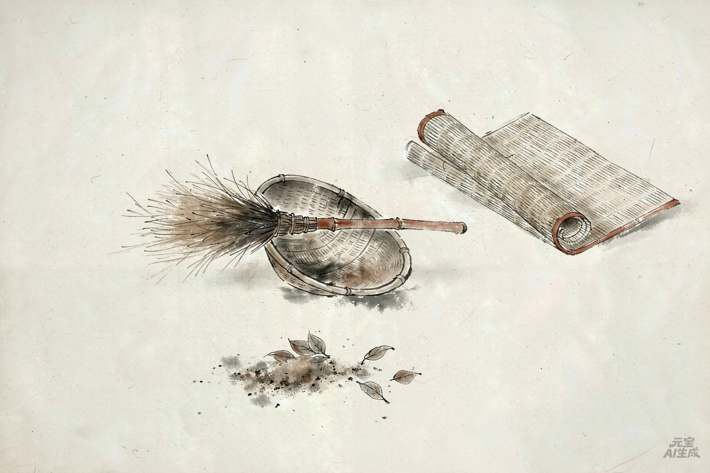

# 第三十二课　为长者粪之礼

> 曲礼上 · 一·三十三 · 第 32 课

## 一　解题

这一节讲给长者扫地、奉席、问席向：扫地先把帚放在箕上，用衣袖遮着帚往后退着扫，使尘土不扑到长者，收秽时箕口朝自己；奉席如桥衡，左高右低；铺席先问面向，铺卧席先问足向；席的上下，南向北向以西方为上，东向西向以南方为上。

**说什么事**：凡为长者粪之礼，必加帚于箕上，以袂拘而退，其尘不及长者，以箕自乡而扱之；奉席如桥衡；请席何乡，请衽何趾；席南乡北乡，以西方为上；东乡西乡，以南方为上。

**落在哪一层**：教。上节讲步与手，这节讲手上有物时怎么做。

**为何编在此位**：一·三十一讲空手之度，此节讲持物之度；侍长者的活计，从扫地起。

## 二　经文

【经】凡為長者糞之禮，必加帚於箕上，以袂拘而退，其塵不及長者，以箕自鄉而扱之。奉席如橋衡。請席何鄉，請衽何趾。席南鄉北鄉，以西方為上；東鄉西鄉，以南方為上。

## 三　字义与句读

**粪**　此处作扫除解。疏：「埽席前曰粪。」

**加帚于箕上**　郑注：「如是得两手奉箕，恭也。……《弟子职》曰：『执箕膺擖，厥中有帚。』」——帚放在箕里，两手捧箕而入。

**以袂拘而退**　郑注：「谓埽时也。以袂拥帚之前，埽而却行之。」——袖遮帚前，边扫边退。

**以箕自乡而扱之**　郑注：「扱读曰吸，谓收粪时也。箕去弃物，以乡尊者则不恭。」疏：「扱，敛取也……必读扱为吸者，以其秽物少，吸然则尽。」

**奉席如桥衡**　郑注：「横奉之，令左昂右低，如有首尾然。桥，井上桔槔，衡上低昂。」

**请席何乡，请衽何趾**　郑注：「顺尊者所安也。衽，卧席也。坐问乡，卧问趾，因于阴阳。」

**席之上下**　郑注：「布席无常，此其顺之也。上，谓席端也。坐在阳则上左，坐在阴则上右。」疏：南坐是阳，其左在西；北坐是阴，其右亦在西，故俱以西方为上。

## 四　今译

凡给长者扫除，一定把帚放在箕上，用衣袖遮着帚往后退着扫，让尘土不扑到长者；收秽时箕口朝自己。捧席要像井上桔槔的横木，左高右低。铺坐席先问面向哪边，铺卧席先问脚朝哪边。席若南向北向，以西方为上；东向西向，以南方为上。

## 五　章旨

一节三事：扫、奉、布。三事都在「不让尘土、不逆尊者、不擅作主」上——礼的细，细到袖口与箕口的方向。

## 六　礼义

**第一层　「加帚于箕上」是进门时的姿态**　郑注说透：「如是得两手奉箕，恭也。」帚在箕里，才能两手捧；两手捧，才不是扛着扫帚进门。疏引《管子·弟子职》「执箕膺擖，厥中有帚」——箕舌朝胸，帚在箕中，这是弟子入室的定式。姿态在前，劳动在后。

**第二层　「袂拘而退」是把尘挡在自己这一侧**　袖遮帚前，边扫边退。尘土的去向由你控制：不是扫得干净，是扫得「不及其长者」。礼在这里给了一个可检验的标准：长者身上有没有灰。

**第三层　「箕自乡而扱之」是连秽物的朝向都管**　箕是弃物之器。收秽时箕口朝自己，不朝尊者——秽物所向，也是敬所向。疏解「扱」读作「吸」，取其敛尽之意。这一条琐到近乎可笑，然而礼正是这样一寸一寸立起来的。

**第四层　「奉席如桥衡」：持物的斜度**　横捧一席，左高右低，如桔槔之衡。为什么？席有首尾，捧时也要分出首尾；左高右低，是把「上端」递向尊者。

**第五层　「请席何乡，请衽何趾」：不替尊者定方向**　坐席问面，卧席问足，皆「顺尊者所安」。疏以阴阳为说：坐为阳，面亦阳；卧为阴，足亦阴。今日观之，其要在「问」而不在「阴阳」：方向是尊者的，不是你替他摆好的。

**第六层　「席之上下」：上下不在高低，在左右**　南向北向以西方为上，东向西向以南方为上。疏解「坐在阳则上左，坐在阴则上右」。这一条今日最难懂，也最见古礼的性格：尊位不是一个抽象的高处，而是一个具体的、按坐向算出来的方位。

**与今日何干**　今日请人入座，多是「您随便坐」。「随便」看似客气，其实是把定方向的活推给了客人。此节反过来：方向要问，席要摆对，连尘土往哪儿飞都要先想好。

## 七　分寸与边界

- **不可**把「粪」当作粪土之事。此处是扫除。
- **不可**把「袂拘而退」做成背对长者倒着走。所取者是遮尘与退行，不是背礼。
- **不可**把「箕自乡」做成把秽物留在堂上。所论者是收秽时的朝向。
- **不可**把「奉席如桥衡」做成两端歪斜。左昂右低有定，非随手倾侧。
- **不可**把「席之上下」当成风水方位。注疏皆以坐向与阴阳为说，非卜筮。

## 八　存疑

- **「粪」字之义**　注疏作扫除，字本有粪除之意，后世或误读。本课从注。
- **「扱」的读法**　郑读为「吸」，谓敛取使尽；通行或读本字。本课从郑。
- **「桥衡」的形制**　郑以井上桔槔之衡为喻，其制今不尽可考。本课只取「左昂右低」之义。
- **「席南乡北乡以西方为上」的理据**　以阴阳贵左贵右为说，是否周遍，注疏未详。本课从注。
- **礼席与常席之别**　疏明言「此据平常布席如此，若礼席则不然」，引《乡饮酒礼》为异。本课分说，不混。

## 九　跨典

- 《管子·弟子职》：「执箕膺擖，厥中有帚。」——郑注引，为加帚于箕之据。
- 《礼记·曲礼上》一·三十一：「堂上接武，堂下布武。」——同是堂上动作之度。
- 《礼记·乡饮酒礼》：「宾席牖前南面，主人席阼阶上西面。」——疏引，见礼席布向与常席不同。
- 《礼记·曲礼上》一·三十四：「席间函丈。」——紧接此节，讲客席之间隔。

## 十　双卡

| 左 | 右 |
| --- | --- |
| 加帚于箕上 | 两手奉箕，恭也 |
| 以袂拘而退 | 袖拥帚前，埽而却行 |
| 以箕自乡而扱之 | 箕去弃物，乡尊者则不恭 |
| 奉席如桥衡 | 左昂右低，如有首尾 |
| 请席何乡，请衽何趾 | 顺尊者所安，坐问乡、卧问趾 |
| 席南乡北乡，以西方为上 | 坐在阳则上左，坐在阴则上右 |

## 十一　图

<figure>

<figcaption>图一 · 帚在箕中，席半卷 · lj032a（作者供图）</figcaption>
</figure>

{{fig:lj032b-sao-xi-san-shi|图二 · 扫席三事：帚、袂、箕 · lj032b}}
