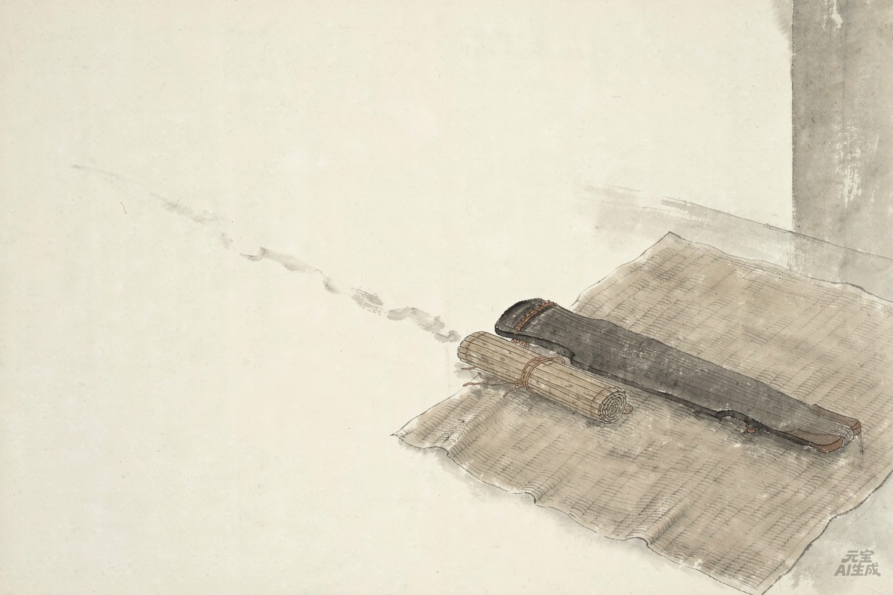

# 第三十四课　将即席，容毋怍

> 曲礼上 · 一·三十五＋一·三十六 · 第 34 课

## 一　解题

这一节讲弟子初入席的分寸：将要就席，脸色不可变动；两手提起衣裳，使下摆离地一尺；衣裳不可飞扬；脚步不可急遽。接着一句：师长的书简琴瑟在跟前，要跪着挪开，不可跨过去。

**说什么事**：将即席，容毋怍；两手抠衣，去齐尺；衣毋拨；足毋蹶。先生书策琴瑟在前，坐而迁之，戒勿越。

**落在哪一层**：教。上节讲客席之间隔，这节讲自己如何走过去坐下。

**为何编在此位**：一·三十四是「席怎么布」，此节是「人怎么入席」；布与入相接。

## 二　经文

【经】將即席，容毋怍。兩手摳衣，去齊尺。衣毋撥。足毋蹶。先生書策琴瑟在前，坐而遷之，戒勿越。

## 三　字义与句读

**怍**　郑注：「怍，颜色变也。」疏：「初将来就席，颜色宜庄，不得变动颜色。」

**抠衣、去齐尺**　郑注：「齐谓裳下缉也。」疏：「以两手当裳前提挈裳使起，令裳下缉去地一尺，恐衣长转足蹑履之。」

**拨**　郑注：「拨，发扬貌。」——裳摆扬起。

**蹶**　郑注：「蹶，行遽貌。」疏：「勿得以为行遽，恐有蹶踬之貌。」

**坐而迁之**　郑注：「广敬也。在前，谓当行之前。」疏：「坐亦跪也，坐通名跪，跪名不通坐也。」

**戒勿越**　疏：「越，逾也。弟子将行，若遇师诸物或当己前，则跪而迁移之，戒慎勿得逾越。」

## 四　今译

将要就席，脸色不可变动；两手提起衣裳，使下摆离地一尺；衣裳不可扬起；脚步不可急遽。师长的书简、琴瑟在跟前，就跪着把它挪开，切勿跨过。

## 五　章旨

一节讲的是「走过去」的三个不许：色不许变、衣不许扬、足不许急；再一句讲「过不去时怎么办」：不跨，跪着挪。敬，在这一小段路程上全部显形。

## 六　礼义

**第一层　「容毋怍」：先把脸定住**　就席是一段被看见的路程：众人都坐着，你一人走来。郑注只说「颜色变」，疏说得实：「初将来就席，颜色宜庄。」——紧张、慌忙、得意，都写在脸上；礼先管脸。

**第二层　「抠衣去齐尺」：为的是不踩到自己的衣裳**　疏把理由说得极具体：「恐衣长转足蹑履之。」提裳一尺，是不让下摆绊脚。礼在这里不是姿态，是防跌；敬的外形，往往就是「不出错」的外形。

**第三层　「衣毋拨，足毋蹶」：不许带风**　衣扬是急，足遽是慌。两样都是「赶」的样子；就席而带风，是把全堂的目光都拽过来。

**第四层　「坐而迁之，戒勿越」：物在人前，人不越物**　郑注四字「广敬也」。师长的书、琴瑟放在道上，弟子不跨，跪下挪开。疏又辨一字：「坐亦跪也，坐通名跪，跪名不通坐」——此处之「坐」实是跪。物的尊严，由人的膝盖来表达。

**与今日何干**　今日入座，多是边走边说话、跨过别人的包与书。此节给的次序很旧也很灵：先把脸定住，再把衣裳提起，脚步不快；前头有别人的东西，不跨，挪开。

## 七　分寸与边界

- **不可**把「容毋怍」做成面无表情。所戒者是色变，非不许有神。
- **不可**把「去齐尺」做成提着衣裳走路。所论者是就席之顷。
- **不可**把「足毋蹶」做成寸步挪移。所戒者是急遽之貌。
- **不可**把「坐而迁之」当成可以随手搬动尊者之物。跪而迁，是敬，不是整理。
- **不可**把「勿越」做成绕远。所禁者跨越，非不许经过。

## 八　存疑

- **「怍」是惭还是变**　郑训「颜色变」，疏申为「变动颜色」；后世或解为惭怍。本课从郑。
- **「去齐尺」的尺是周尺否**　注未言尺度。本课只取「离地一尺」之义。
- **「书策琴瑟」是否泛指师之物**　郑注「在前，谓当行之前」，似泛指。本课从注。
- **「坐」与「跪」之别**　疏明言「坐通名跪，跪名不通坐」；然他篇又分坐、跪、跽。本课只录疏说。
- **此节是否专为讲问之弟子**　疏云「此明弟子讲问初来之法」。本课从疏。

## 九　跨典

- 《礼记·玉藻》：「圈豚行，不举足，齐如流。」——同是行步之容。
- 《礼记·曲礼上》一·二十九：「抠衣趋隅，必慎唯诺。」——同是抠衣就席，彼在客，此在弟子。
- 《礼记·曲礼上》一·二十三：「毋践屦。」——同是「不越人物」之意。
- 《论语·乡党》：「摄齐升堂，鞠躬如也。」——可与此节抠衣去齐相参。

## 十　双卡

| 左 | 右 |
| --- | --- |
| 将即席，容毋怍 | 颜色宜庄，不得变动 |
| 两手抠衣，去齐尺 | 恐衣长转足蹑履 |
| 衣毋拨，足毋蹶 | 拨，发扬貌；蹶，行遽貌 |
| 书策琴瑟在前，坐而迁之 | 广敬也；坐亦跪也 |
| 戒勿越 | 越，逾也；不跨而过 |

## 十一　图

<figure>

<figcaption>图一 · 简琴横在来路 · lj034a（作者供图）</figcaption>
</figure>

{{fig:lj034b-ru-xi-san-jie|图二 · 入席三节：色、衣、足 · lj034b}}
