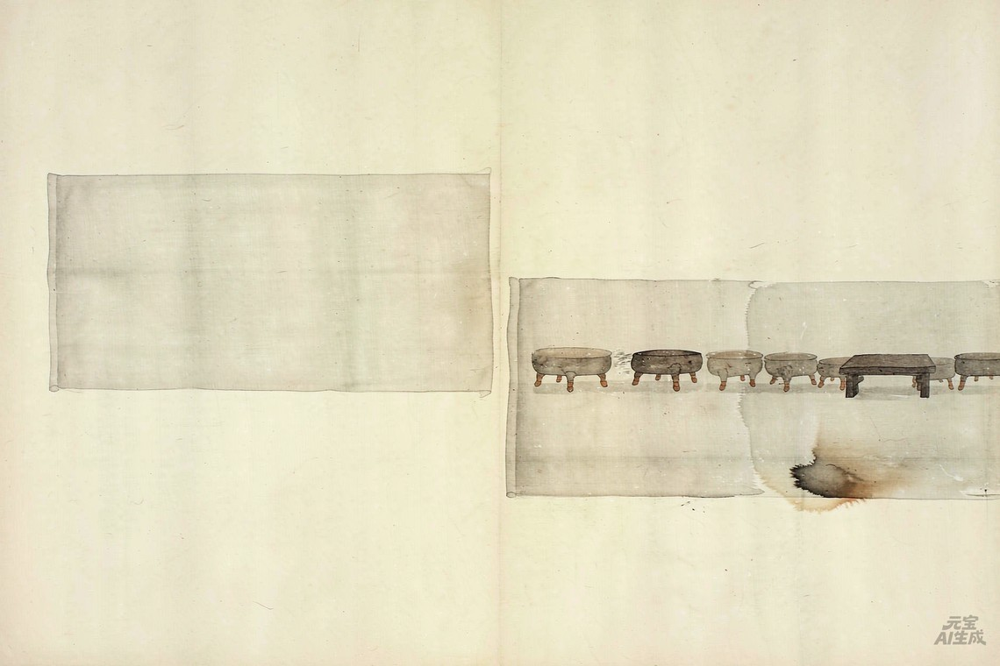

# 第三十五课　虚坐尽后，食坐尽前

> 曲礼上 · 一·三十七 · 第 35 课

## 一　解题

这一节讲坐的位置与坐的样子：空坐（非饮食之坐）尽量靠后，饮食之坐尽量靠前；坐要安稳，守住你的脸色。

**说什么事**：虚坐尽后，食坐尽前；坐必安，执尔颜。

**落在哪一层**：教。上节讲入席的路，这节讲坐定之后的位置与身体。

**为何编在此位**：一·三十四讲「怎么走过来」，此节讲「坐在哪里、怎么坐」。

## 二　经文

【经】虛坐盡後，食坐盡前。坐必安，執爾顏。

## 三　字义与句读

**虚坐**　郑注：「虚，空也。空谓非饮食坐也。」疏：「尽后，不敢近前，以为谦也。」

**食坐**　郑注：「食坐尽前，为污席。」疏：「古者地铺席，而俎豆皆陈于席前之地，若坐近后则溅污席，故尽前也。」

**两处引证**　疏引《玉藻》：「徒坐不尽席尺」「读书、食则齐豆去席尺」。

**坐必安**　疏：「凡坐好自摇动，故戒之令必安坐。」

**执尔颜**　郑注：「执犹守也。」疏：「久坐好异，故必戒之宜如乡者无作颜容。」

## 四　今译

空坐就尽量靠后，饮食之坐就尽量靠前。坐必定安稳，守住你的脸色。

## 五　章旨

四句两事：位置（前后）与身体（安稳、颜色）。礼连「坐得多靠前」都定了，因为前后一差，谦与污便分。

## 六　礼义

**第一层　虚坐尽后：无事的坐，往后是谦**　郑注先把「虚」解清：非饮食之坐。疏一句「不敢近前，以为谦也」——没有事的时候，你往前挪一寸，就是往前挤人。

**第二层　食坐尽前：有事的坐，往前是防**　同样一席，饮食之时却要尽前。理由极实：「若坐近后则溅污席。」俎豆陈在席前，坐后则汤汁溅席。所以这一前一后不是尊卑，是两件不同的事各有其位。

**第三层　坐必安：不许摇**　疏「凡坐好自摇动」。久坐而摇，是心不在；礼以「安」为坐之德。

**第四层　执尔颜：久坐而色不变**　郑注「执犹守也」，疏「久坐好异……宜如乡者无作颜容」——刚坐下时的神色，坐一个时辰还得是那个神色。此条最难：礼能管一刻，管不了一时。

**与今日何干**　今日开会，坐得越靠后越安全，坐得越靠前越显得积极；而身子摇晃、表情走神，几乎无人管。此节给的是一把很静的尺：位置看事，安稳看心。

## 七　分寸与边界

- **不可**把「虚坐尽后」做成躲到墙角。所论者是席内之后，非离席。
- **不可**把「食坐尽前」做成抢上座。所论者是同一席上的前后，非位次尊卑。
- **不可**把「坐必安」做成僵坐不动。所戒者是摇动，非不许起伏。
- **不可**把「执尔颜」做成面无表情。所守者是「如乡者」，非抹去神色。
- **不可**把此节读成坐姿仪范。注疏所论者在谦与污，非审美。

## 八　存疑

- **「虚坐」是否兼指讲问之坐**　郑只言「非饮食坐」，未列其目。本课从注。
- **「不尽席尺」之尺**　疏引《玉藻》，其尺制未详。本课不补。
- **「食坐尽前」是否及于尊者**　注疏皆就常礼言，未分尊卑。本课存疑。
- **「执尔颜」之「尔」指谁**　注疏未明，或指自指，或指侍者。本课从「自守其色」。
- **「坐必安」与「寝毋伏」的关系**　一在坐，一在卧，注未合论。

## 九　跨典

- 《礼记·玉藻》：「徒坐不尽席尺。」「读书、食则齐豆去席尺。」——疏引，为此节之据。
- 《礼记·曲礼上》一·三十四：「席间函丈。」——同论席上之位。
- 《礼记·曲礼上》一·四十三（下批）：「坐毋箕。」——同论坐之形。
- 《礼记·曲礼上》一·三十五：「将即席，容毋怍。」——彼论入席之色，此论坐定之色。

## 十　双卡

| 左 | 右 |
| --- | --- |
| 虚坐尽后 | 非饮食坐；不敢近前，以为谦 |
| 食坐尽前 | 俎豆陈前，坐后则溅污席 |
| 坐必安 | 凡坐好自摇动，故戒之 |
| 执尔颜 | 执犹守也；久坐不作颜容 |

## 十一　图

<figure>

<figcaption>图一 · 左席留空，右席贴豆 · lj035a（作者供图）</figcaption>
</figure>

{{fig:lj035b-qian-hou-zhi-wei|图二 · 前后之位：谦与污 · lj035b}}
