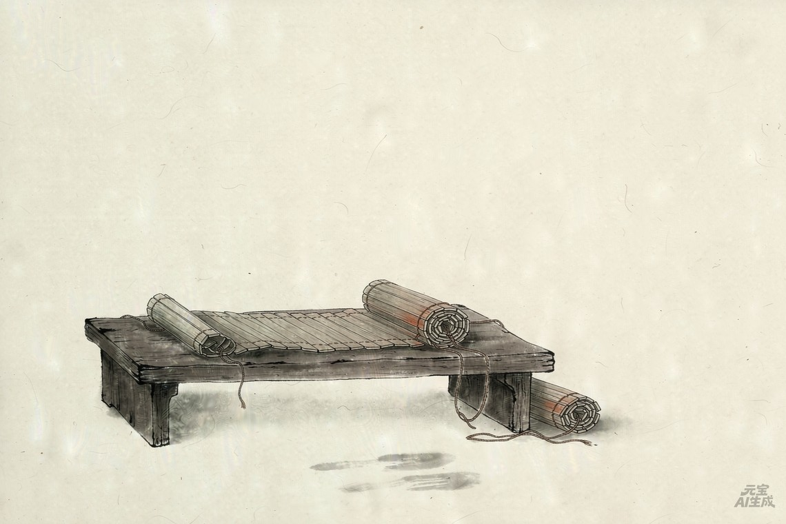

# 第三十六课　长者不及，毋儳言

> 曲礼上 · 一·三十八 · 第 36 课

## 一　解题

这一节讲在长者说话时怎么听、怎么答：长者没说到的事，不要插话；端正你的仪容；听的时候务必恭敬。

**说什么事**：长者不及，毋儳言；正尔容，听必恭。

**落在哪一层**：教。上节讲坐，这节讲坐在长者面前时口与容。

**为何编在此位**：坐定了才有听；先有位，后有言。

## 二　经文

【经】長者不及，毋儳言。正爾容，聽必恭。

## 三　字义与句读

**不及**　疏：「及谓所及之事也。」——长者正说之事。

**儳言**　郑注：「儳犹暂也，非类杂。」疏：「长者正论甲事，未及乙事，少者不得辄以乙事杂甲事，暂然杂错师长之说。」

**正尔容**　疏：「正谓矜庄也。方受先生之道，当正己矜庄也。颜、容通语耳。」

**听必恭**　郑注：「听先生之言，既说又敬。」疏：「听师长之说，宜恭敬也。」

## 四　今译

长者没有说到的事，不要插话。端正你的仪容，听的时候务必恭敬。

## 五　章旨

三句说一件事：把口与身都收在长者的话里。不许岔，不许散，不许慢。

## 六　礼义

**第一层　「不及」是界线，不是话题**　疏解得最准：「长者正论甲事，未及乙事，少者不得辄以乙事杂甲事。」——界线画在长者「说到哪里」，不在「你知道多少」。你恰有一件更精彩的乙事，也不许此刻端上来。

**第二层　「儳」是「暂」，是插一下就走**　郑训「儳」为暂，又补「非类杂」。插话的特点正是短：一句、半句，把话头挪开，然后回到原处。礼所禁者，就是这半句。

**第三层　「正尔容」：受道之时身体要立起来**　疏「方受先生之道，当正己矜庄」。听人说话是受，受则身正；身一斜，话就进不去。

**第四层　「听必恭」：郑注「既说又敬」**　「说」读作悦：听懂了、听高兴了，仍要敬。这一条最难：人一高兴，便会接话、便会身子前倾。礼在此加一道闸。

**与今日何干**　今日交谈最大的病是「抢」：抢话题、抢结论、抢着懂。此节只说三件事：不插、不散、不慢。

## 七　分寸与边界

- **不可**把「毋儳言」做成不敢说话。长者问到，仍须对。
- **不可**把「不及」解成「不懂的不许问」。所禁者是杂错话头，非禁问。
- **不可**把「正尔容」做成僵坐。所取者是矜庄，非不许动。
- **不可**把「听必恭」做成唯唯。恭敬在心，不在点头的次数。
- **不可**把此节专施于童子。注疏言「少者」，其义通于一切在长者前的人。

## 八　存疑

- **「儳」的读与义**　郑训「暂」，陆德明列三读。本课从郑。
- **「长者」与「先生」之别**　崔灵恩谓「长者直以年为称」。此处注疏未分，本课从通称。
- **「正尔容」是否含坐姿**　疏只言矜庄，未及坐形。本课不补。
- **「听必恭」的「恭」如何验**　注无实指。本课以「不接话、不前倾」为说，属申义。
- **插问与插言的分界**　注未明。本课存疑。

## 九　跨典

- 《礼记·曲礼上》一·三十九：「毋剿说，毋雷同。」——同是言之戒，彼在立论，此在听言。
- 《礼记·曲礼上》一·四十：「先生问焉，终则对。」——同是「不抢」，彼在答，此在听。
- 《论语·季氏》：「侍于君子有三愆：言未及之而言谓之躁。」——可与此节相参。
- 《礼记·学记》：「待问者如撞钟。」——同是应问而后鸣。

## 十　双卡

| 左 | 右 |
| --- | --- |
| 长者不及，毋儳言 | 儳犹暂也，非类杂 |
| 长者论甲未及乙 | 不得以乙事杂甲事 |
| 正尔容 | 矜庄以受先生之道 |
| 听必恭 | 既说又敬 |

## 十一　图

<figure>

<figcaption>图一 · 简展一半，另卷在案外 · lj036a（作者供图）</figcaption>
</figure>

{{fig:lj036b-bu-cha-bu-san|图二 · 听言之三戒：不插、不散、不慢 · lj036b}}
