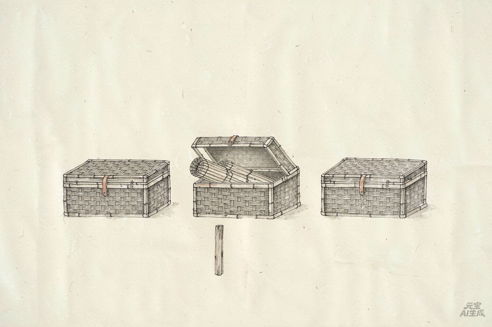

# 第三十七课　毋剿说，毋雷同

> 曲礼上 · 一·三十九 · 第 37 课

## 一　解题

这一节讲立言的三条：不掠取别人的说法算自己的；不随声附和一齐说是；一定以古昔为法、称述先王。

**说什么事**：毋剿说，毋雷同，必则古昔，称先王。

**落在哪一层**：教。上节讲听，这节讲话：听来的话要自己长出根，才说得出口。

**为何编在此位**：先「毋儳言」收住口，再定「说什么」——一收一放，方是言礼。

## 二　经文

【经】毋剿說。毋雷同。必則古昔，稱先王。

## 三　字义与句读

**剿说**　郑注：「剿犹揽也，谓取人之说以为己说。」

**雷同**　郑注：「雷之发声，物无不同时应者。人之言，当各由己，不当然也。」引《孟子》「人无是非之心，非人也」。

**必则古昔**　郑注：「言必有依据。」疏：「则，法也。虽不雷同，又不得专辄，故当必法于古昔之正。」

**称先王**　疏：「先王，圣人为天子者也。……如孔子说《孝经》，称『先王有至德』也。」

## 四　今译

不掠取别人的话当作自己的话；不象雷响一样众声同应；一定要以古昔为法，称述先王。

## 五　章旨

三条其实是一条：话要有主。剿说是偷主，雷同是弃主；则古昔、称先王，是给自己找一个更高的主。

## 六　礼义

**第一层　剿说是「偷」**　郑训「剿」为「揽」，揽即搂取：把别人说的搂过来，说成自己说的。今日所谓「复述即原创」，正是此病。礼不问你懂不懂，先问你哪句话是谁的。

**第二层　雷同是「弃」**　郑注取雷声为喻：雷一响，万物同时应声。他说得好：「人之言，当各由己，不当然也。」——「然」是「以为然」；礼所戒者，不是附和别人，是把自己的「然」交出去。

**第三层　则古昔是「有据」，不是「有靠山」**　郑注四字「言必有依据」。疏再补：「虽不雷同，又不得专辄。」——不随声，也不任性；两头都关着，中间才是「法古」。

**第四层　称先王：把话头抬到可公议之处**　疏举《孝经》「先王有至德」为例。称先王不是搬古董，是把争论从「我说」挪到「古之圣人曾如此说」，使对方可查、可驳。

**与今日何干**　今日语境的两种病，此节都点了：一是搬运（洗稿、套话、转述当己见），二是合唱（同温层一齐「确实如此」）。第三条给的是治法：把话接到可核的源头上去。

## 七　分寸与边界

- **不可**把「毋剿说」做成凡引必注。所禁者是据为己有，非禁引用。
- **不可**把「毋雷同」做成凡同必反。所禁者是随声，非不许与人同。
- **不可**把「则古昔」做成复古。所法者是「正」，非句式与名物。
- **不可**把「称先王」做成抬人压人。疏言「言必有依据」，其意在据，不在势。
- **不可**把此节限于经生之文。注疏所论者是「为人之法」，通于一切言语。

## 八　存疑

- **「剿说」之「剿」的读**　郑训「揽」，陆氏列二切。本课从郑。
- **「雷同」是否兼指附和时议**　郑注只以雷声为喻，未指对象。本课从「各由己」。
- **「古昔」与「先王」是一是二**　疏分言之，似「古昔」为时，「先王」为人。本课依疏。
- **不雷同而不专辄，如何两全**　注只言「有依据」，未出方法。本课存疑。
- **此节是否专指弟子答问**　疏置于「事师」一段，然其言泛。本课作通论看。

## 九　跨典

- 《孟子·告子上》：「人无是非之心，非人也。」——郑注引，证「各由己」。
- 《孝经·开宗明义章》：「先王有至德要道。」——疏引，证「称先王」。
- 《论语·为政》：「述而不作，信而好古。」——可与「则古昔」相参。
- 《礼记·曲礼上》一·三十八：「长者不及，毋儳言。」——彼禁抢话头，此禁盗话头。

## 十　双卡

| 左 | 右 |
| --- | --- |
| 毋剿说 | 剿犹揽也，取人之说为己说 |
| 毋雷同 | 雷发声，物无不同时应 |
| 人之言当各由己 | 不当然：不以他人之然为然 |
| 必则古昔 | 则，法也；虽不雷同，亦不专辄 |
| 称先王 | 言必有依据 |

## 十一　图

<figure>

<figcaption>图一 · 三笥并置，一开二闭 · lj037a（作者供图）</figcaption>
</figure>

{{fig:lj037b-li-yan-san-ze|图二 · 立言三则：不偷、不随、有据 · lj037b}}
