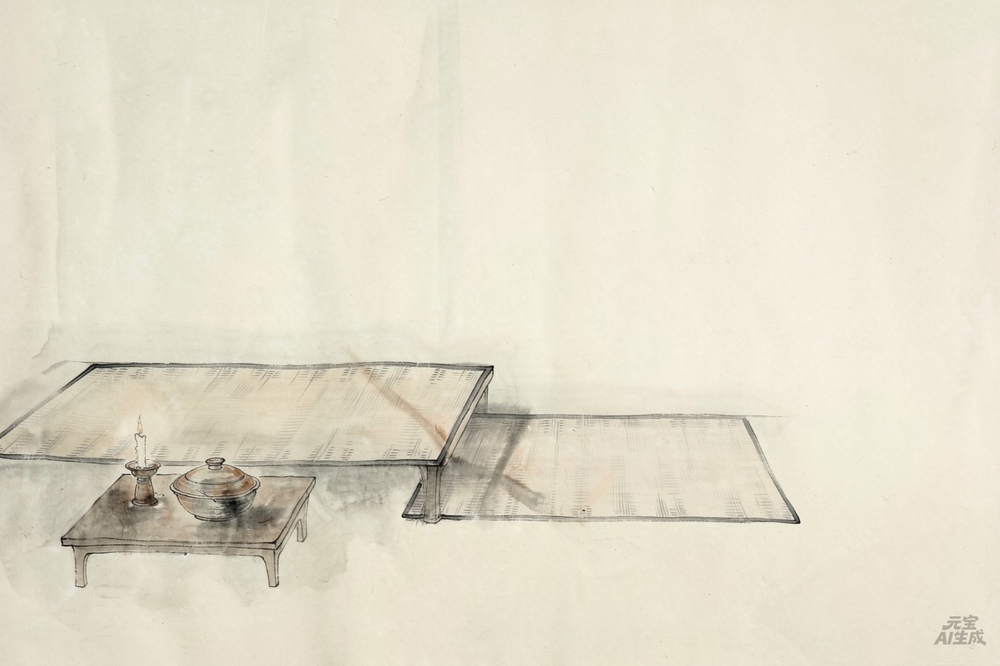

# 第三十九课　侍坐于所尊敬，毋余席

> 曲礼上 · 一·四十一 · 第 39 课

## 一　解题

这一节讲侍坐时的坐次与起身：在所尊敬的人旁边侍坐，不要在自己与尊者之间空出余席，要尽量贴近尊者那一端；见同等的人来不起身；烛来要起，食来要起，上客来要起。

**说什么事**：侍坐于所尊敬，毋余席，必尽其所近尊者之端；见同等不起；烛至起；食至起；上客起。

**落在哪一层**：教。上节讲应答，这节讲坐得离尊者多近，以及什么时候必须起身。

**为何编在此位**：坐次定，起止才有据；一静一动，合成侍坐之礼。

## 二　经文

【经】侍坐於所尊敬，毋餘席，必盡其所近尊者之端。見同等不起。燭至起。食至起。上客起。

## 三　字义与句读

**毋余席**　郑注：「必尽其所近尊者之端，为有后来者。」疏：「己必坐于近尊者之端，勿得使近尊者之端更有空余之席。」

**见同等不起**　郑注：「不为私敬。」疏：「虽见己之同等后来，不为之起，任其坐在下空处。」

**烛至起**　郑注：「异昼夜。」

**食至起**　郑注：「为馔变。」

**上客起**　郑注：「敬尊者。」疏：「尊者见之则起，故侍者宜从之而起。然食与烛至起，则尊者不起。」

## 四　今译

在所尊敬的人旁边侍坐，不要留出余席，要挨近尊者那一端坐。见到同等的人来，不起身。烛送来时起身，食送来时起身，上客来时起身。

## 五　章旨

一节分两半：坐要「贴」，起要「准」。贴着尊者，是备问；起身只三种，是不滥敬。

## 六　礼义

**第一层　毋余席：坐近，是为了备问**　郑注的理由有二，疏说得全：「欲得亲近先生，似若扶持然，备拟先生顾问，不可过远；且拟后人之来，故阙其在下空处以待之。」——近的一端给自己，远的一端留给后来的人。

**第二层　「必尽其所近尊者之端」：一寸也不虚**　不是「坐得近些」，是「不留空」。疏说「勿得使近尊者之端更有空余之席」——尊者身旁那一段席面，不许空着。

**第三层　见同等不起：不拿私敬打断公敬**　郑注四字「不为私敬」。朋友来了，你起身迎他，就把尊者搁在一边了。礼在这里的取舍很清楚：尊者之前，私交要收。

**第四层　三起：烛、食、上客**　烛至是昼夜之变，食至是馔之变，上客至是尊者要起。三条都不是「尊敬来人」，而是「事变了」。疏又补一句要紧：「食与烛至起，则尊者不起」——你起，尊者不必起。

**与今日何干**　今日陪长辈、陪领导，常坐得远远的「不打扰」；来宾一到，又忙着起身招呼。此节反过来：坐要贴，起要有数。贴身是备问，起身是随事。

## 七　分寸与边界

- **不可**把「毋余席」做成紧挨着人坐。所论者是席端不留空，非贴身。
- **不可**把「见同等不起」做成目中无人。所禁者是为私交而起，非不许招呼。
- **不可**把「烛至起」做成见灯就站。所论者是侍者之礼，且尊者不起。
- **不可**把「三起」推为凡客皆起。经只列三事。
- **不可**把此节读成坐次等级。注疏所重者在备问与让后。

## 八　存疑

- **「所尊敬」是否即「先生」**　注未明言，疏多以先生为说。本课从通称。
- **「余席」是席面之余，还是另席**　疏作「席端空余」解。本课从疏。
- **「上客」之等如何定**　注无明文。本课不补。
- **同等者来时坐在何处**　疏云「任其坐在下空处」，即己所阙之下端。此说可通，然注未言。
- **尊者不起而侍者起，是否失次**　疏明言如此。本课依疏。

## 九　跨典

- 《礼记·曲礼上》一·二十九：「户外有二屦。」——同是「先察后入」，彼在门外，此在席端。
- 《礼记·曲礼上》一·三十五：「虚坐尽后。」——彼言无事则后，此言侍尊则贴，两不相违。
- 《论语·乡党》：「侍食于君，君祭，先饭。」——同是侍尊之节。
- 《礼记·少仪》：「侍坐，弗使不执琴瑟。」——可相参。

## 十　双卡

| 左 | 右 |
| --- | --- |
| 侍坐于所尊敬，毋余席 | 为有后来者 |
| 必尽其所近尊者之端 | 备顾问，且阙下以待后人 |
| 见同等不起 | 不为私敬 |
| 烛至起 | 异昼夜 |
| 食至起 | 为馔变 |
| 上客起 | 敬尊者；尊者不起 |

## 十一　图

<figure>

<figcaption>图一 · 两席相接，烛影在中 · lj039a（作者供图）</figcaption>
</figure>

{{fig:lj039b-tie-yu-qi|图二 · 贴与起：一坐三起 · lj039b}}
