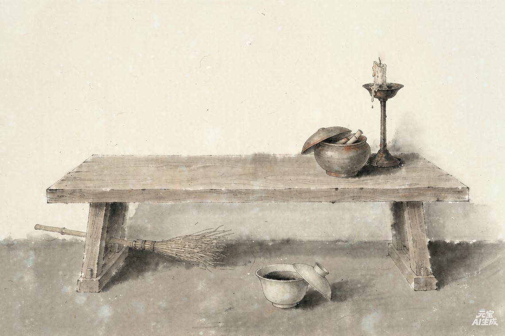

# 第四十课　烛不见跋

> 曲礼上 · 一·四十二 · 第 40 课

## 一　解题

这一节讲三件客前之戒：烛烧尽了不见残本；尊客在堂不叱狗；让食时不吐。

**说什么事**：烛不见跋；尊客之前不叱狗；让食不唾。

**落在哪一层**：教。上节讲三起，这节讲三不：不显夜深、不显倦、不显嫌。

**为何编在此位**：起是「事到」，不显是「事过」；一进一藏，客礼乃全。

## 二　经文

【经】燭不見跋。尊客之前不叱狗。讓食不唾。

## 三　字义与句读

**跋**　郑注：「跋，本也。烛尽则去之，嫌若烬多有厌倦。」疏引《小尔雅》：「跋，本也。本，把处也。」

**烛**　疏：「古者未有蜡烛，唯呼火炬为烛也。火炬照夜易尽，尽则藏所然残本。」

**不叱狗**　郑注：「主人于尊客之前不敢倦，嫌若风去之。」疏：「叱骂于狗，则似厌倦其客欲去之。」

**让食不唾**　郑注：「嫌有秽恶。」

## 四　今译

烛烧尽不要把残本留着让人看见。尊客在堂，不叱骂狗。让人进食时不吐口水。

## 五　章旨

三条都在「藏」：藏夜深，藏倦意，藏嫌恶。客礼的高处，不在多做，在不让人看出你盼他走。

## 六　礼义

**第一层　烛不见跋：用一支烛计算时间**　疏说得最实：「若积聚残本，客见之，则知夜深，虑主人厌倦，或欲辞退也。」——堆着的烛头是钟表。礼的办法是「恒如然未尽」：让客人以为还早。

**第二层　此条的深处是不欺**　不显夜深，不是骗客人时辰，是不把「我倦了」的证据摆在案上。今日宾主看表、看手机，与此同类：都是无声的逐客令。

**第三层　不叱狗：怒气不落在旁人身上**　郑注「嫌若风去之」：主人骂狗，客人听成骂己。疏再加一句：「卑客亦当然，举尊为甚。」——此礼通于一切来客。

**第四层　让食不唾：不让人看见你的嫌**　「让食」是劝食；一面劝人吃，一面吐，是把嫌弃显出来。此条最琐，也最见礼的性格：礼不管你好恶，只管你显不显。

**与今日何干**　今日待客，多的是当面看表、语音抱怨、手机刷屏。此节给的三「藏」，可直用：不在客前看时辰，不当客前面露不耐，不对客所荐之物作嫌态。

## 七　分寸与边界

- **不可**把「烛不见跋」做成故意瞒人。所藏者是倦意，非事之实。
- **不可**把「不叱狗」只作狗看。注明言「嫌若风去之」，指桑骂槐皆在其内。
- **不可**把「让食不唾」做成强吞。所戒者是当人吐，非不许辞。
- **不可**把此节限于富贵之家。疏言卑客亦当然。
- **不可**把「藏」做成假。礼所藏者是己之倦与嫌，非掩事之要。

## 八　存疑

- **「跋」是烛本还是烛架**　郑训「本」，疏申为「把处」；后世或解作烛足之架。本课从郑。
- **「烛」是火炬还是蜡烛**　疏明言古未有蜡烛，通呼火炬。本课从疏。
- **「让食」是劝食还是让食于人**　注未细析，疏以「让食」连文。本课从「劝食」。
- **三戒是否同一场合**　注未言。本课依经文连读。
- **「不唾」与「不敢咳」之别**　注未及。本课不补。

## 九　跨典

- 《小尔雅·广诂》：「跋，本也。」——郑疏引，为「烛不见跋」之训。
- 《礼记·曲礼上》一·四十一：「烛至起。」——同以烛为节，彼起，此藏。
- 《礼记·少仪》：「尊长于己逾等，不敢问其年。」——同是客前之谨。
- 《礼记·曲礼上》一·二十九：「将上堂，声必扬。」——同是「不掩人之私」的另面。

## 十　双卡

| 左 | 右 |
| --- | --- |
| 烛不见跋 | 跋，本也；嫌若烬多有厌倦 |
| 藏残本，恒如未尽 | 不使客知夜深 |
| 尊客之前不叱狗 | 嫌若风去之 |
| 让食不唾 | 嫌有秽恶 |

## 十一　图

<figure>

<figcaption>图一 · 烛本入盂，帚倚案下 · lj040a（作者供图）</figcaption>
</figure>

{{fig:lj040b-san-cang|图二 · 三藏：夜深、倦意、嫌恶 · lj040b}}
