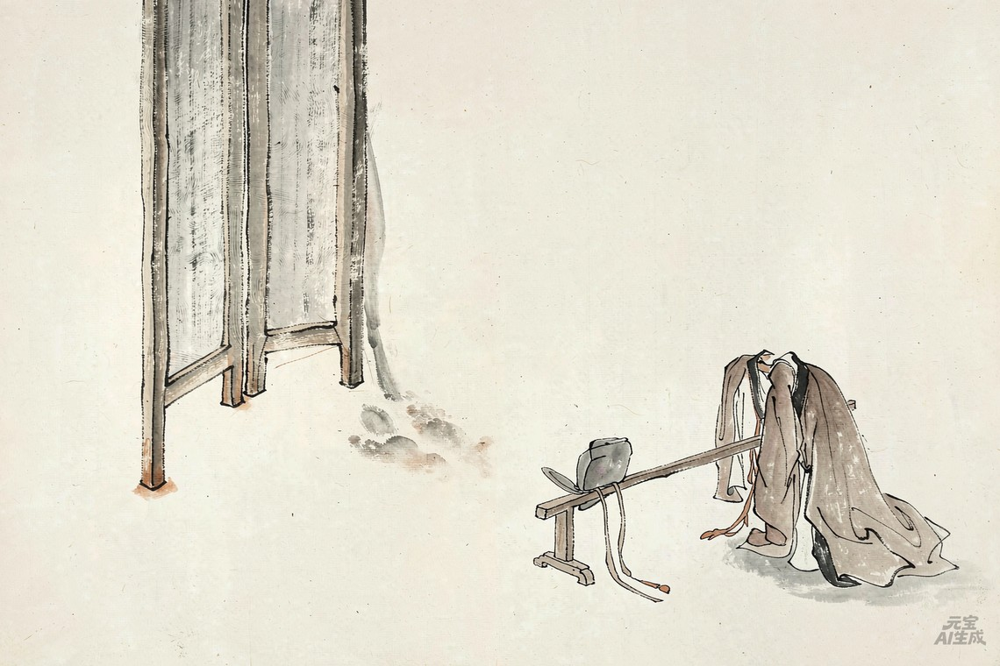

# 第四十二课　毋侧听，毋噭应

> 曲礼上 · 一·四十四 · 第 42 课

## 一　解题

这一节是一串容止之戒：不侧耳偷听，不高声应答，不流动斜视，不放散身体；行走不倨慢，站立不偏倚，坐不张腿如箕，卧不覆面；头发不垂如假髻，冠不脱，劳不袒，暑不掀裳。

**说什么事**：毋侧听，毋噭应，毋淫视，毋怠荒；游毋倨，立毋跛，坐毋箕，寝毋伏；敛发毋髢，冠毋免，劳毋袒，暑毋褰裳。

**落在哪一层**：教。上节讲进退，这节讲站在那儿时全身的十二个不许。

**为何编在此位**：退有节，立亦有节；一节收口，一节开口，都是身体的礼。

## 二　经文

【经】毋側聽，毋噭應，毋淫視，毋怠荒。遊毋倨，立毋跛，坐毋箕，寢毋伏。斂髮毋髢，冠毋免，勞毋袒，暑毋褰裳。

## 三　字义与句读

**侧听**　郑注：「嫌探人之私也。侧听，耳属于垣。」

**噭应**　郑注：「噭，号呼之声也。」疏：「应答宜徐徐而和，不得高急。」

**淫视**　郑注：「淫视，睇眄也。」疏：「目当直瞻视，不得流动邪盻。」

**怠荒**　郑注：「放散身体也。」

**倨、跛、箕、伏**　郑注：「跛，偏任也。」「伏，覆也。」疏：「箕谓舒展两足，状如箕舌也。」

**髢、免、袒、褰**　郑注：「髢，髲也，毋垂余如髲也。免，去也。褰，袪也。」疏：「暑虽炎热，而不得褰袪取凉也。」

## 四　今译

不侧耳偷听，不高声应答，不流动斜视，不放散身体。行走不倨慢，站立不偏倚一足，坐不张腿如箕，卧不覆面。头发收敛不垂如假髻，冠不脱去，劳倦不袒露，暑热不掀裳。

## 五　章旨

十二戒，一半管耳目口，一半管四肢与衣冠。礼在此只做一件事：把身体收在「正」上——不倾、不张、不露。

## 六　礼义

**第一层　侧听与淫视：耳目是最会越界的**　郑注「耳属于垣」四字极妙：侧听时耳朵几乎贴到墙上。淫视是「流动邪盻」。两戒同一理：耳目可以去，但不许偷偷去。

**第二层　噭应与怠荒：声与身都不许放**　噭是号呼之声，怠荒是「放散身体」。一放声、一放身，都是把自己的存在扩到别人身上。

**第三层　倨、跛、箕、伏：四种「偏」**　倨是行而慢，跛是「偏任」一足，箕是张腿如箕舌，伏是覆面而卧。四者都是失了「中」：偏在一侧、偏在一处。

**第四层　髢、免、袒、褰：衣冠是最后一道**　垂发如髲、脱冠、袒身、掀裳，四样都是「解」。礼在暑与劳两处最见力：热也要穿衣，累也不袒——不是不知热，是不以热为理由。

**第五层　疏末一句最要紧**　「然上诸事条目，诫侍者左右屏隐之人也……亦可通戒为人之法。」——这十二戒本是给那些退到屏后、无人看管的人说的：一退到暗处，人就容易放肆。礼预先在那里立了规矩。

**与今日何干**　今日的侧听是偷看手机、探听私聊；噭应是公共场合大声通话；箕坐是摊在座位上。此节不必照搬衣冠，取「不倾、不张、不露」三字即可。

## 七　分寸与边界

- **不可**把「毋侧听」做成不许听人说话。所禁者是贴耳探私。
- **不可**把「毋噭应」做成低声下气。所取者是和缓，非畏怯。
- **不可**把「立毋跛」做成并足僵立。所戒者是偏任一足。
- **不可**把「暑毋褰裳」做成苦热。注取其「不以热为辞」，非不许解衣。
- **不可**把此节做成容貌苛评。疏明言「通戒为人之法」，其义在节，不在貌。

## 八　存疑

- **「髢」是假髻还是垂发**　郑注「髲也，毋垂余如髲」，两义相含。本课从注。
- **「跛」是倚物还是偏足**　郑训「偏任」。本课从郑。
- **「箕」的具体坐形**　疏「舒展两足，状如箕舌」。本课从疏。
- **十二戒是否尽为侍者而设**　疏谓本诫屏隐之人，又可通戒。本课两存。
- **「劳毋袒」与「暑毋褰裳」是否绝对**　注不言例外。本课存疑。

## 九　跨典

- 《礼记·曲礼上》一·二十六：「立必正方，不倾听。」——童子之教，与此节同源。
- 《礼记·少仪》：「毋侧听」类文互见。
- 《论语·乡党》：「立不中门，行不履阈。」——同是身体之节。
- 《礼记·玉藻》：「足容重，手容恭，目容端。」——可相参。

## 十　双卡

| 左 | 右 |
| --- | --- |
| 毋侧听 | 嫌探人之私，耳属于垣 |
| 毋噭应 | 号呼之声；应答宜和 |
| 毋淫视 | 睇眄；目当直瞻 |
| 毋怠荒 | 放散身体 |
| 游毋倨，立毋跛 | 慢；偏任 |
| 坐毋箕，寝毋伏 | 舒足如箕舌；覆也 |
| 敛发毋髢，冠毋免 | 不垂如髲；不去冠 |
| 劳毋袒，暑毋褰裳 | 不以劳暑为辞 |

## 十一　图

<figure>

<figcaption>图一 · 屏后半掩，冠衣在架 · lj042a（作者供图）</figcaption>
</figure>

{{fig:lj042b-shi-er-jie|图二 · 容止十二戒：不倾、不张、不露 · lj042b}}
