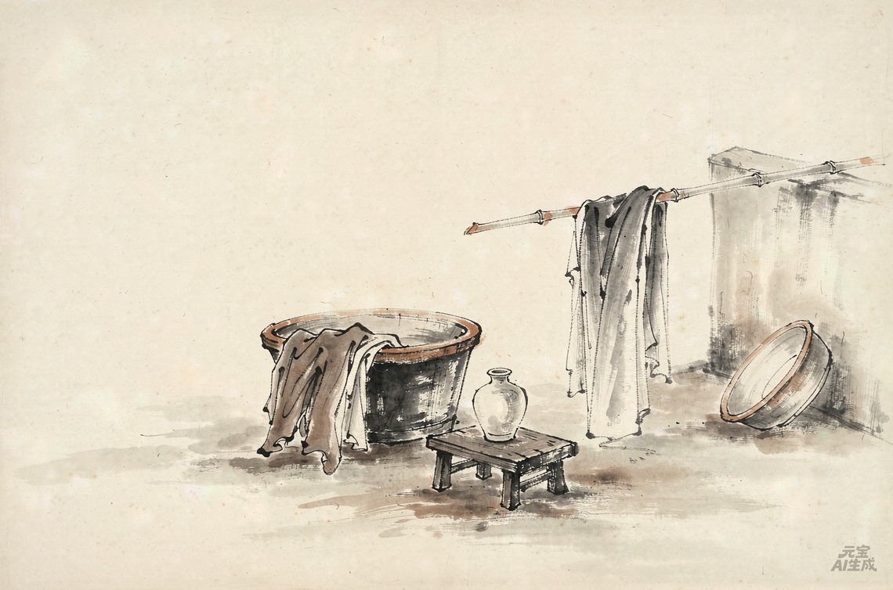

# 第四十六课　嫂叔不通问

> 曲礼上 · 一·四十八 · 第 46 课

## 一　解题

嫂嫂与小叔子之间不通信问；庶母可以替你洗衣，不可以替你洗裳。

**说什么事**：嫂叔不通问，诸母不漱裳。

**落在哪一层**：教。上节讲男女之不共物，此节讲亲属之间的两处「不」。

**为何编在此位**：一·四十七讲泛言之别，此节讲亲属近处之别；越是近亲，线越要显。

## 二　经文

【经】嫂叔不通問，諸母不漱裳。

## 三　字义与句读

**嫂叔不通问**　郑注：「通问谓相称谢也。」——不是不许见面，是不相称谢、不相通候问。

**诸母**　郑注：「诸母，庶母也。」疏：「诸母谓父之诸妾有子者。」——父之妾而有子者。

**不漱裳**　郑注：「漱，浣也。庶母贱，可使漱衣，不可使漱裳。裳贱，尊之者亦所以远别。」疏：「诸母贱，乃可使漱浣盛服，而不可使漱裳，裳，卑亵也，欲尊崇于兄弟之母，故不可使漱裳耳，又欲远别也。」

## 四　今译

嫂嫂与小叔子之间不相通问。庶母可以洗衣服，不可以洗下裳。

## 五　章旨

两处「不」，方向相反：对嫂叔是「不使近」，对庶母是「不使卑」。前者防嫌，后者尊人；同一条界线，一头护己，一头护人。

## 六　礼义

**第一层　不通问：不称谢**　注把「通问」限在「相称谢」。称谢是往来之始：谢一次，就有第二次；有第二次，就有单独的往来。礼在这里截断，不是截断亲，是截断单独。

**第二层　诸母不漱裳：不使尊长碰卑亵**　疏说得清楚：盛服可浣，裳不可。裳是下体之衣，最卑亵；让父之妾去洗它，是把尊长按到最卑处。所以此条不是防淫，是「尊崇于兄弟之母」。

**第三层　两「不」的指向**　嫂叔之不，为远别；诸母之不，为尊崇。同一节里，礼既防嫌又护尊，可见「别」从来不是单向的压制。

**第四层　「有子」二字**　疏特标「诸妾有子者」。有子则为诸母，无子则否；名分定了，礼才落得下去。

**与今日何干**　今日叔嫂通问无碍，但「不让长辈替你处理最私的衣物」一条仍在：请人帮忙，帮到哪一层为止，是敬。

## 七　分寸与边界

- **不可**把「不通问」做成不认亲。注只限「称谢」，不及问安、共事。
- **不可**把「诸母」做成乳母、保姆。注明言「庶母」。
- **不可**把「不漱裳」解成嫌秽。疏义是「尊之」，不是嫌之。
- **不可**把此节做成男女大防的总纲。全节只两条，各有所指。
- **不可**以今日之变否认当日之制，亦不可以当日之制律今日之人。

## 八　存疑

- **「通问」是否含问疾吊丧**　注只举「称谢」。本课从严。
- **「裳」是下裳还是泛指衣服**　注以「裳贱」与「衣」对举，指下裳。本课从注。
- **庶母无子者是否亦在不漱裳之列**　疏以「有子」为诸母。本课从疏。
- **嫂叔之服**　经注未及。本课不考。
- **「漱」是否即浣洗全衣**　注「漱，浣也」。本课从注。

## 九　跨典

- 《礼记·内则》：「非祭非丧，不相授器。」——同一别之原则，彼论授受，此论洗浣。
- 《孟子·离娄上》：「嫂溺援之以手者，权也。」——礼有经有权，嫂叔之别亦当如是读。
- 《礼记·曲礼上》一·四十七：「男女不杂坐。」——此节为其近亲之目。
- 《礼记·丧服》「嫂叔无服」之说，后世聚讼，本课不引。

## 十　双卡

| 左 | 右 |
| --- | --- |
| 嫂叔不通问 | 通问谓相称谢也 |
| 诸母 | 庶母也；父之诸妾有子者 |
| 诸母不漱裳 | 可使漱衣，不可使漱裳 |
| 何以不漱裳 | 裳卑亵；尊兄弟之母，又欲远别 |
| 两不之指 | 一为远别，一为尊崇 |
| 有子为诸母 | 名定而后礼行 |

## 十一　图

<figure>

<figcaption>图一 · 嫂叔不通问 · lj046a（作者供图）</figcaption>
</figure>

{{fig:lj046b-liang-bu|图二 · 两不：一远别，一尊崇 · lj046b}}
