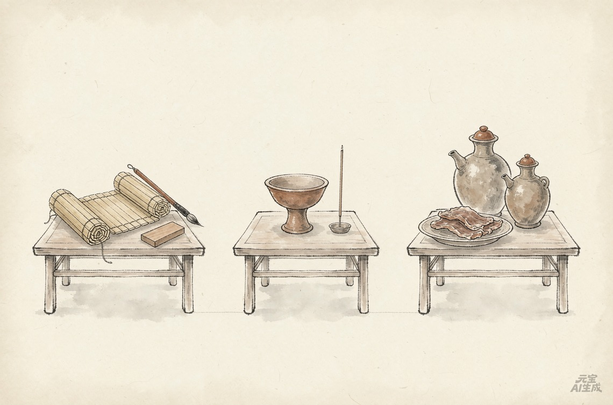

# 第五十课　日月以告君

> 曲礼上 · 一·五十二 · 第 52 课

## 一　解题

娶妇的年月日时，写下来告国君；斋戒告鬼神；备酒食召乡党僚友。三告之后，「以厚其别」——把两个人的事，变成众人知道的事。

**说什么事**：故日月以告君，齐戒以告鬼神，为酒食以召乡党僚友，以厚其别也。

**落在哪一层**：教。上节讲婚前的三级门，此节讲婚后的三处告。

**为何编在此位**：一·五十一讲「有凭」，此节讲「有证」；凭在两人之间，证在众人之间。

## 二　经文

【经】故日月以告君，齊戒以告鬼神，為酒食以召鄉黨僚友，以厚其別也。

## 三　字义与句读

**日月以告君**　郑注：「《周礼》凡取判妻入子者，媒氏书之以告君，谓此也。」疏：「既男女须辨，故妇来，则书取妇之年月日时，以告国君也。」

**齐戒以告鬼神**　郑注：「《昏礼》凡受女之礼，皆于庙为神席以告鬼神，谓此也。」疏：「嫁女之家受于六礼，并在庙布席告先祖也。明女是先祖之遗体，不可专辄许人。而取妇之家，父命子亲迎，乃并自齐洁，但在己寝，不在庙也。所以尔者，《白虎通》云：『娶妻不告庙者，示不必人女也。』然夫家若无父母，则三月庙见，亦是告鬼神。」

**为酒食以召乡党僚友**　郑注：「会宾客也。」

**以厚其别也**　郑注：「厚，重慎也。」

## 四　今译

所以把娶妇的年月日告国君，斋戒以告鬼神，备酒食召乡党僚友——以此加重那分别。

## 五　章旨

三告：告君是登记，告鬼神是承祖，告乡党僚友是公开。三者合起来，才叫「厚其别」：别之所以厚，不在两人之间说得清，而在众人都知道。

## 六　礼义

**第一层　告君：留下日子**　注引《周礼·媒氏》「凡取判妻入子者，媒氏书之以告君」。所书者是「年月日时」。婚姻在礼里有一份可查的日期，不是私事无凭。

**第二层　告鬼神：女是先祖的遗体**　疏说得重：「明女是先祖之遗体，不可专辄许人。」嫁女之家在庙布席告先祖；取妇之家父命子亲迎，齐洁在己寝而不在庙。

**第三层　取妇不告庙**　疏引《白虎通》「娶妻不告庙者，示不必人女也」——不敢说人家一定把女儿给过来。这一句最见分寸：告鬼神是诚，不告庙是谦。

**第四层　告乡党僚友：把私事变成公事**　注只说「会宾客也」。酒食一摆，婚事就成了邻里共知之事；「厚其别」的「厚」，正是众人共知之后的分量。

**与今日何干**　今日有登记、有婚礼、有朋友圈。登记是告君，婚礼是告亲友，中间那一层「告鬼神」多半没了。此节提醒的是：三者不全，别就不厚。

## 七　分寸与边界

- **不可**把「告君」读成官府批准婚姻。所书者是日月，不是许可。
- **不可**把「告鬼神」做成必在庙行礼。注已明言取妇之家不在庙。
- **不可**把「召乡党僚友」做成铺张。注「会宾客」而已，礼数不在厚薄。
- **不可**把「厚其别」读成加重隔阂。厚者是「重慎」，不是疏远。
- **不可**只取「婚礼大办」一节而弃前两告。

## 八　存疑

- **「判妻」「入子」之义**　注引郑注「判合」与「容媵及侄娣不聘者」。本课不深考。
- **告君是告国君还是告官**　注以《周礼·媒氏》为说，是官司之书。本课从注。
- **三月庙见是否即告鬼神**　疏言「亦是告鬼神」。本课从疏，标为别条。
- **「齐戒」之齐读斋还是齐**　注文作「齐戒」，义为斋戒。本课从义。
- **乡党与僚友之别**　注统言「宾客」。本课不析。

## 九　跨典

- 《周礼·媒氏》：「凡娶判妻入子者，皆书之。」——注引，是「告君」之据。
- 《白虎通》：「娶妻不告庙者，示不必人女也。」——疏引，见取妇之谦。
- 《礼记·昏义》：「昏礼者，将合二姓之好，上以事宗庙，而下以继后世也。」——告鬼神之义。
- 《礼记·曲礼上》一·五十一：「非受币，不交不亲。」——凭在两人，证在众人。

## 十　双卡

| 左 | 右 |
| --- | --- |
| 日月以告君 | 媒氏书取妇年月日时以告君 |
| 齐戒以告鬼神 | 嫁女之家于庙布席告先祖 |
| 取妇之家 | 父命子亲迎，齐洁在寝不在庙 |
| 娶妻不告庙 | 示不必人女也（《白虎通》） |
| 无父母则三月庙见 | 亦是告鬼神 |
| 为酒食以召乡党僚友 | 会宾客也 |
| 以厚其别 | 厚，重慎也 |

## 十一　图

<figure>

<figcaption>图一 · 日月以告君 · lj050a（作者供图）</figcaption>
</figure>

{{fig:lj050b-san-gao|图二 · 三告：君、鬼神、乡党 · lj050b}}
