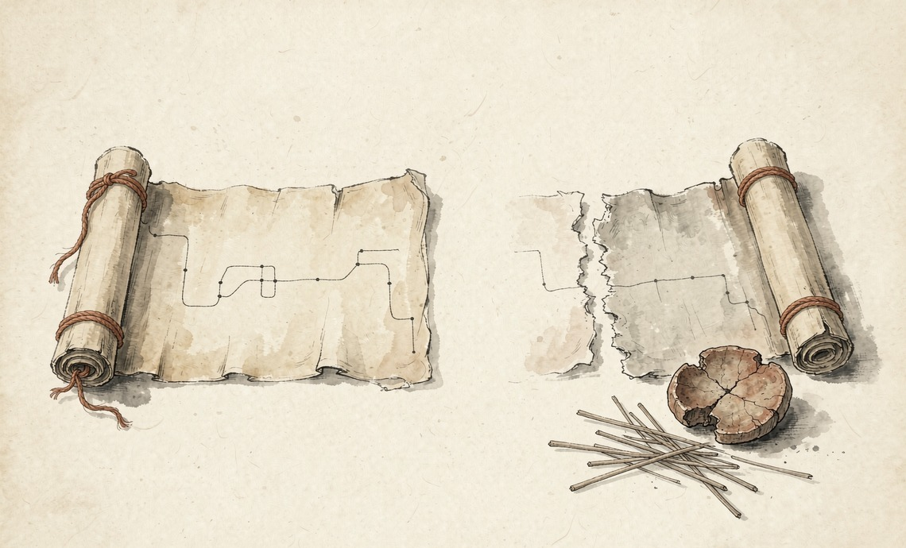

# 第五十一课　取妻不取同姓

> 曲礼上 · 一·五十三 · 第 51 课

## 一　解题

娶妻不娶同姓；买妾而不知其姓，就卜。姓是本系，本系断了，才用卜来补。

**说什么事**：取妻不取同姓，故买妾不知其姓，则卜之。

**落在哪一层**：教。上节讲婚姻的三告，此节讲婚姻的第一条禁。

**为何编在此位**：一·五十二讲「厚其别」，此节讲「别」的底线：无别则近禽兽。

## 二　经文

【经】取妻不取同姓，故買妾不知其姓，則卜之。

## 三　字义与句读

**不取同姓**　郑注：「为其近禽兽也。」

**买妾不知其姓，则卜之**　郑注：「妾贱，或时非媵，取之于贱者，世无本系。」疏：「诸侯取一国之女，则二国同姓以侄娣媵……或时非此媵类，取于贱者，不知何姓之后，则世无本系，但卜得吉者取之。」

**疏引《郊特牲》**　「无别无义，禽兽之道。」注云：「此不取同姓，为其近禽兽故也。」

**熊氏说**　「卜者卜吉凶。既不知其姓，但卜吉，则取之。」

## 四　今译

娶妻不娶同姓。所以买妾而不知她的姓，就用卜来决定。

## 五　章旨

一条禁，一条补。禁是同姓不婚；补是不知姓则卜。禁所守者是「有本系」，补所济者是「本系已失」——礼在守不住的地方，留了一条可走的门。

## 六　礼义

**第一层　「为其近禽兽」**　注只有这五个字，说得极重：同姓相婚，等于没有别；没有别，就近于禽兽。疏引《郊特牲》「无别无义，禽兽之道」，把这一条的底说透——不是卫生，是「有没有别」。

**第二层　姓即本系**　注说「世无本系」。姓是一条可追的线：知道姓，就知道来处。买妾于贱者，这条线断了；断了，礼就无从守。

**第三层　卜：不得已的补法**　熊氏说「卜吉凶，卜吉则取之」。此卜不是问姓，是问可不可。礼不能替她找回本系，只能就当下求一个可。

**第四层　媵与侄娣**　疏说诸侯娶一国女，同姓二国以侄娣媵——媵有名有姓，故不须卜。可知「不知其姓」是一条窄路，专为最贱者留。

**与今日何干**　今日姓已混，同姓不婚早已不行。但此节留下的是另一条：任何「本系不明」的结合，都要有一个额外的确认程序，而不是装作知道。

## 七　分寸与边界

- **不可**把「同姓不取」读成优生学。注只说「近禽兽」，义在「无别」。
- **不可**把「卜之」当随意决疑。疏以「卜吉」为说，是有限度的确认。
- **不可**把此条推广为「异姓即可」。经只立一禁，未立「皆可」。
- **不可**以今日姓制否认古义。古姓与今姓不同，义在追系，不在字面。
- **不可**只引禁令而不引卜法。两者是一节。

## 八　存疑

- **同姓之「姓」是姓还是氏**　注以「本系」为说。本课不辨姓氏之别。
- **卜者是卜姓还是卜吉**　熊氏主卜吉，疏存其说。本课从熊氏。
- **媵是否皆知其姓**　疏以媵为同姓二国之女，当知其姓。本课从疏。
- **「买妾」之买是否即买卖**　注以「取于贱者」为说。本课不深论。
- **此条在当时是否通行**　《左传》多违礼之例。本课只论经义。

## 九　跨典

- 《礼记·郊特牲》：「无别无义，禽兽之道。」——注疏引，是此条之底。
- 《左传·僖公二十三年》：「男女同姓，其生不蕃。」——同姓之戒，见于《春秋》。
- 《国语·晋语》：「同姓不婚，恶不殖也。」——同义而异辞。
- 《礼记·曲礼上》一·五十二：「以厚其别也。」——同以「别」为纲。

## 十　双卡

| 左 | 右 |
| --- | --- |
| 取妻不取同姓 | 为其近禽兽也 |
| 无别无义，禽兽之道 | 故不取同姓 |
| 妾贱，或时非媵 | 取之于贱者，世无本系 |
| 不知其姓，则卜之 | 卜吉则取之（熊氏） |
| 媵 | 同姓二国以侄娣媵，姓可知 |
| 卜是补法 | 非问姓，是问可 |

## 十一　图

<figure>

<figcaption>图一 · 取妻不取同姓 · lj051a（作者供图）</figcaption>
</figure>

{{fig:lj051b-ben-xi-duan|图二 · 本系：可追与已断 · lj051b}}
