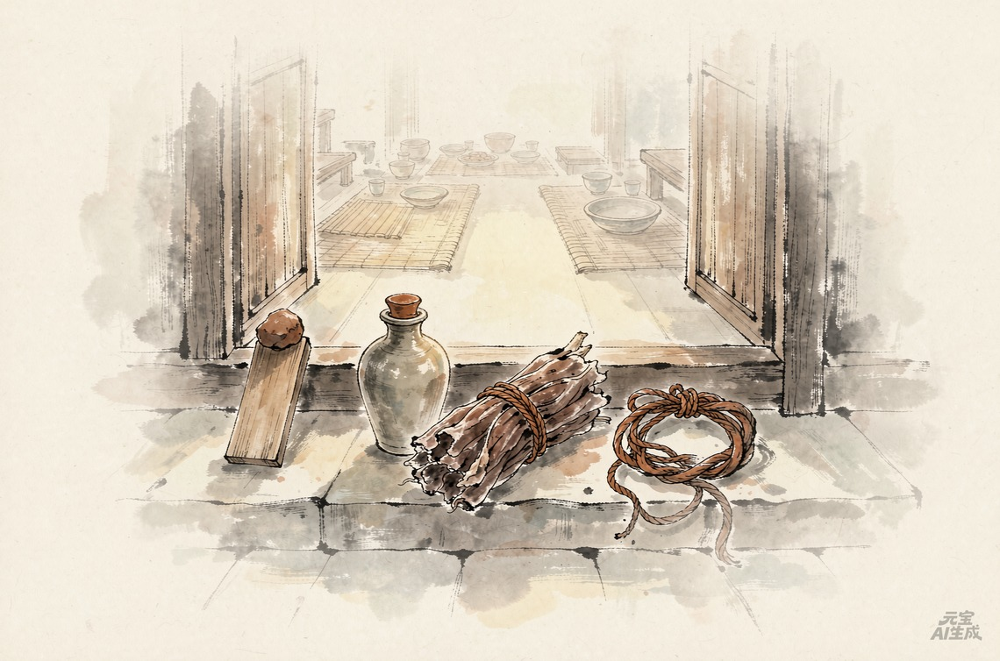

# 第五十三课　贺取妻者

> 曲礼上 · 一·五十五 · 第 55 课

## 一　解题

亲友娶妻，自己有事去不了，派人送礼，辞是这样说的：「某子使某，闻子有客，使某羞。」不说贺，只说听说你家里有客，让我送点酒食来。

**说什么事**：贺取妻者，曰：「某子使某，闻子有客，使某羞。」

**落在哪一层**：教。上节讲交友之慎，此节讲庆吊之辞。

**为何编在此位**：一·五十四讲「嫌」，此节讲「辞」；嫌既难避，辞可以绕。

## 二　经文

【经】賀取妻者，曰：「某子使某，聞子有客，使某羞。」

## 三　字义与句读

**贺取妻者**　疏：「谓亲朋友有昏，己有事碍不得自往，而遣人往也。」

**某子使某**　疏：「『某子』者，贺者名。『使某』者，使自称名也。言彼使我来也。」

**闻子有客**　疏：「『闻子』，呼娶妻者为子也。昏礼既不称贺，故云『闻子有客』也。客者，乡党僚友之属也。」

**使某羞**　郑注：「羞，进也，言进于客。」疏：「子既召宾客，或须饮食，故使我将此酒食以与子进宾客。」

**不斥主人，昏礼不贺**　郑注。疏引《郊特牲》：「昏礼不贺，人之序也。」

**其礼**　注：「盖壶酒、束脩若犬也。」疏：「束脩，十脡脯也。若无脯，则壶酒及一犬。」

## 四　今译

贺人娶妻，辞曰：「某子派我来，听说你家里有客，让我送些酒食来。」

## 五　章旨

一节全在「辞」上：明明为贺而来，辞里没有一个「贺」字。昏礼不贺，故贺者绕开「贺」，落在「有客」与「送酒食」；礼不许说的，辞设法不说。

## 六　礼义

**第一层　昏礼不贺**　注末四字「昏礼不贺」，是全节的根。疏引《郊特牲》「昏礼不贺，人之序也」——序，是代际接续之序。娶妻不是添喜，是接代；接代这件事，不宜以贺为辞。

**第二层　不斥主人**　注「不斥主人」。不说「贺你娶妻」，只说「闻子有客」。把主语从「你的婚事」移到「你的客人」，一句话就把不宜说的让开了。

**第三层　辞的三层结构**　「某子使某」——谁派我；「闻子有客」——我为什么来；「使某羞」——我带什么来。三层全是事实，没有一句评断。

**第四层　礼与辞的分工**　礼定其不可，辞济其可行。此节最见这一点：礼说昏礼不贺，辞就让「贺」这件事以「送酒食」的样子成立。

**与今日何干**　今日婚礼大贺，无此戒。但「不斥主人」一条仍可用：把话说到事上，不说到人上，许多难说的话就有了出口。

## 七　分寸与边界

- **不可**把「昏礼不贺」做成婚礼不收礼。所戒者是「贺」之辞，不是「送礼」之事。
- **不可**把此辞当虚伪。疏明言「身实不在为贺，故云贺，而其辞则不称贺」——辞与实分得清楚。
- **不可**把「闻子有客」解成推托。客是真有的，酒食是真送的。
- **不可**把「壶酒束脩若犬」当定数。注用「盖」，是推测之辞。
- **不可**只取「不贺」而弃「送礼」。两者是一节的两面。

## 八　存疑

- **「某子」是贺者之名还是其父**　疏以「贺者名」为说。本课从疏。
- **「羞」是否即「进」**　注「羞，进也」。本课从注。
- **「候为进」之古今语转**　注「古者谓候为进」。本课不深考。
- **束脩是否十脡**　疏「束脩，十脡脯也」。本课从疏。
- **「人之序」何解**　疏未详释。本课取「代际接续」之义，标为存疑。

## 九　跨典

- 《礼记·郊特牲》：「昏礼不贺，人之序也。」——疏引，是全节之据。
- 《礼记·少仪》：「其以乘壶酒、束脩、一犬赐人。」——疏引，见礼物的常法。
- 《礼记·曲礼上》一·五十二：「以厚其别也。」——同一婚事，彼重「告」，此重「辞」。
- 《论语·雍也》：「君子博学于文，约之以礼。」——辞之约，亦礼之约。

## 十　双卡

| 左 | 右 |
| --- | --- |
| 贺取妻者 | 亲友有昏，己不得自往而遣人往 |
| 某子使某 | 某子，贺者名；某，使者名 |
| 闻子有客 | 不斥主人；称娶妻者为子 |
| 使某羞 | 羞，进也；进酒食于客 |
| 昏礼不贺 | 人之序也（《郊特牲》） |
| 其礼 | 壶酒、束脩若犬 |

## 十一　图

<figure>

<figcaption>图一 · 贺取妻者 · lj053a（作者供图）</figcaption>
</figure>

{{fig:lj053b-bu-cheng-he|图二 · 贺而不称贺：辞的三层 · lj053b}}
